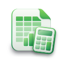
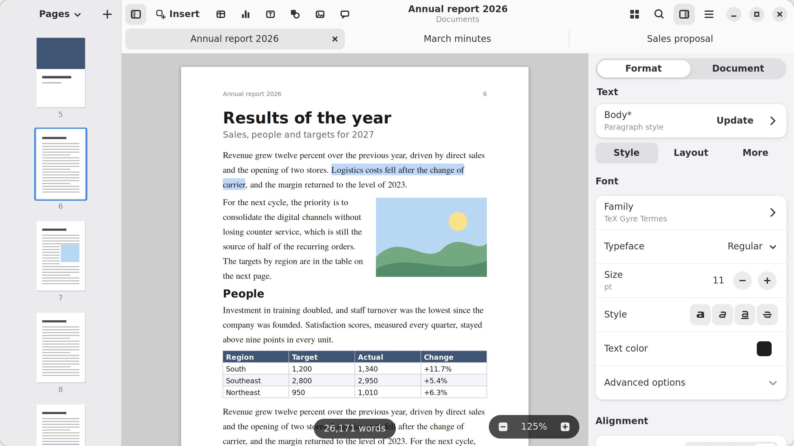
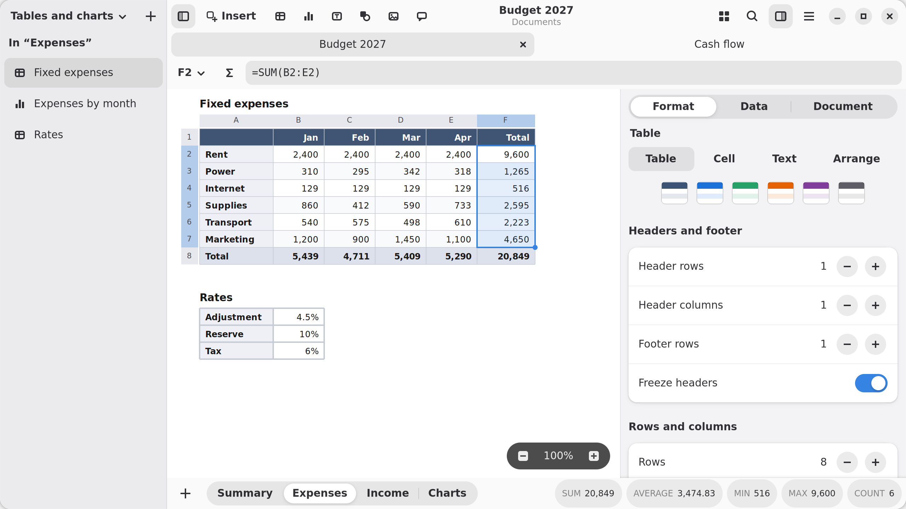
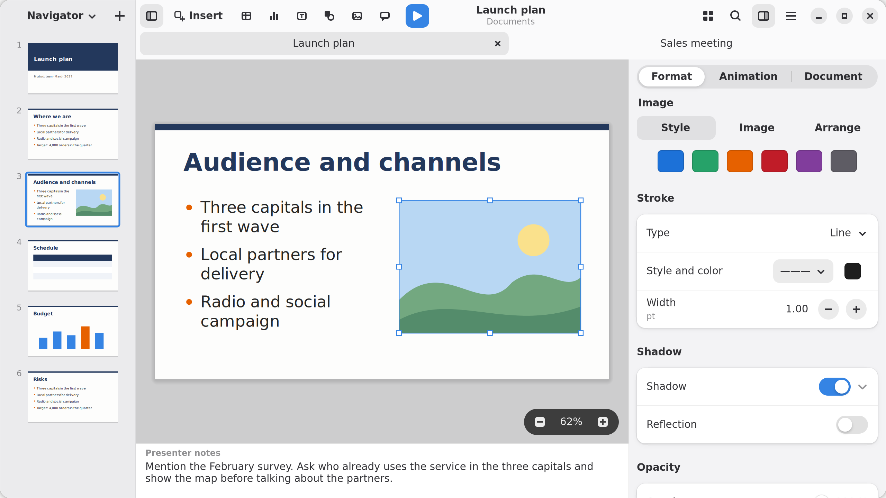

<h1 align="center">
  <picture>
    <source media="(prefers-color-scheme: dark)" srcset="data/logo/desk-logo-dark.svg">
    
  </picture>
</h1>

<p align="center">
  <a href="https://brahm.github.io/desk/">Website</a> ·
  <a href="https://brahm.github.io/desk/painel/">Progress dashboard</a> ·
  <a href="https://github.com/brahm/desk/issues">Report a bug or ask for a feature</a>
</p>

<p align="center">
  
  
  
</p>

Desk is a free office suite of three apps designed to work as one, with
each other and with the GNOME desktop. They share one document model, one
window and one way of doing things, and each of them is simple and focused
on its job without giving up the power that real work needs.

- **Desk Writer**, for word processing and page layout in one app, from a
  school paper to the bakery's flyer.
- **Desk Tables**, for spreadsheets laid out like a page, with several
  free-floating tables and charts on each sheet. It is for organizing and
  calculating, not a business intelligence tool or a database.
- **Desk Slides**, for presentations with themes, transitions, builds and
  a presenter display.

The three apps will share the window below, proposal M+ of
[`docs/interface/proposals`](docs/interface/proposals/README.md) (D-008).
These are mockups drawn with the real GTK 4 and Libadwaita widgets at
1280 × 720, the smallest screen Desk is made for.

<p align="center">
  
  <br><em>Desk Writer</em>
</p>

<p align="center">
  
  <br><em>Desk Tables</em>
</p>

<p align="center">
  
  <br><em>Desk Slides</em>
</p>

## Why Desk

*In the words of its author, Wagner Brahm.*

Desk did not come from a lack of office suites on Linux: LibreOffice and
ONLYOFFICE do that job very well. But neither of them follows the GNOME
Human Interface Guidelines or feels at home on the GNOME desktop. Add to
that my taste for simple tools, which does not mean weak ones, and I chose
to go in the direction of Apple's iWork rather than of Microsoft 365, where
LibreOffice tends to go these days, even though it comes from StarOffice,
which was quite original.

I have always been a fan of iWork '09, from before online collaboration,
AI and subscriptions, and I never got over the move from 32 to 64 bits,
which broke compatibility with my files and took away several unique and
very useful features that I used every day. Today's Pages, Keynote and
Numbers have brought many of them back, some of them behind a paywall.

**Desk is not a clone of iWork.** iWork is the yardstick for what a simple
and capable office suite can do, not a blueprint to copy. The goal is an
office suite with simpler, focused apps, perfectly integrated with GNOME.
Desk Tables does not try to be a business intelligence tool or a database,
for example. The precise target, feature by feature, is in
[docs/goals.md](docs/goals.md): the features of the current Pages, Numbers
and Keynote (15.4), keeping what iWork '09 did and the newer versions lost,
and leaving out what needs AI, an online service or a payment.

## Architecture

The decisions that shape all of Desk. The full picture, with diagrams, is
in [docs/architecture.md](docs/architecture.md), and every decision with
its reason is in [docs/decisions.md](docs/decisions.md).

- **The engine is apart from the interface.** The document model, text
  shaping, pagination, rendering, formulas, charts and file formats are
  Rust crates with no GTK at all. Only `desk-ui` and the three apps use
  GTK 4 and Libadwaita, and the CI enforces it (`ci/check-deps.sh`). That
  is how `desk-convert` turns documents into PDF from the command line, and
  how other projects can reuse the engine.
- **File format libraries anyone can use.** `desk-odf`, `desk-iwork` and
  `desk-formula` depend on no other Desk crate and are licensed under
  MPL-2.0, so that other programs can read and write the same files. The
  apps are GPL-3.0-or-later.
- **One document model, one way to change it.** The three apps share
  `desk-model`, so an object copied from one to another stays the same
  object. Every change is an operation with an inverse, which gives undo,
  and layout is a pure function of the model: the same document gives the
  same pages on screen, in PDF and in the tests.
- **OpenDocument first.** Documents are standard ODF; where ODF has no
  place for a feature, Desk adds a `desk:` extension documented in
  [docs/odf-extensions.md](docs/odf-extensions.md) (D-009). Files of iWork
  '09, current iWork and Microsoft Office come in through `desk-filters`,
  the only place where a format meets the model, and every import reports
  what it could not keep.
- **Native GNOME.** A Libadwaita widget wherever one exists; where none
  does, Desk builds one that follows the HIG and reviews it at each new
  Libadwaita (D-007). Spelling, printing, fonts, file dialogs and the
  screen reader come from the platform.
- **Flatpak on GNOME 51, and nothing online.** Desk ships as a Flatpak on
  the GNOME 51 runtime, with GTK 4.24 and Libadwaita 1.10 (D-013). It has
  no server and no account (D-004).
- **Measured, not guessed.** Every feature is a row of
  [`corpus/inventory`](corpus/inventory/README.md) with its phase and
  tests, and the output is compared with documents made by iWork itself:
  15.4 on a Mac, and 9.3 on a virtual machine for what only iWork '09 has
  (D-020). UI tests drive the apps through the accessibility tree, as a
  screen reader does.

## Where Desk is

Desk Writer came first, because the text engine is the hardest part and
the other two apps depend on it. It has its text engine, document
structure, writing tools, objects, tables and charts
(<!-- parity -->228 of the 329 rows of its parity matrix have tests, 88 of them against what Pages itself laid out, all of them alike<!-- /parity -->):
it opens ODT and Pages '09 documents and saves ODT, edits and formats text
with styles and a screen reader, checks spelling and grammar, lays out
sections, headers, footers, notes and tables of contents as Pages does,
places pictures, shapes, text boxes and media with text wrap, and exports
PDF from the command line with `desk-convert`. It is in beta, still in the
old window. Desk Tables and Desk Slides have their window and engines for
tables, formulas, charts and animation that the apps do not use yet.

Desk is built by Wagner Brahm working with Claude, Anthropic's AI, with
the engineering rigor expected of any team: every change goes through
review and a CI that checks formatting, lints, tests, licenses and the
dependency rules. On 16 November 2026 the project was replanned for its
new goals. The
[progress dashboard](https://brahm.github.io/desk/painel/) (in Portuguese)
shows every feature, phase, open item and the forecast, regenerated from
this repository on each change, and [HISTORY.md](HISTORY.md) lists what is
being done.

## Roadmap

The full plan is [docs/roadmap.md](docs/roadmap.md). In short:

1. **Common base (B1):** the M+ window in the three apps, documents in
   tabs, automatic saving with versions, and the reference documents
   remade on the current iWork.
2. **Desk Writer (W1 to W6):** the behaviour of the current Pages,
   comments and change tracking, page templates and mail merge, new
   objects and charts, `.docx` and current `.pages` files, printing and
   export.
3. **Desk Tables (T1 to T5):** ODS, cells and formulas, sorting, filters,
   categories and pivot tables, charts, `.xlsx` and `.numbers` files.
4. **Desk Slides (S1 to S5):** ODP, themes and masters, text and media,
   transitions and builds, presenting, `.pptx` and `.key` files.
5. **Across the apps and 1.0 (X1):** charts and tables linked between
   documents, copy and paste among the apps, and the final parity report.

After B1 the three app tracks can run side by side. Counted one after the
other, the forecast is feature parity near the end of January 2027, between
10 January and 15 February. It is an estimate, not a commitment, and each
phase corrects it when it ends.

## Install

Desk Writer is in beta, in the Flatpak repository of Desk, which also
has a nightly branch built from `main` every night:

```sh
flatpak remote-add --if-not-exists desk https://brahm.github.io/desk/desk.flatpakrepo
flatpak install desk br.com.brahm.Desk.Writer//beta
flatpak run br.com.brahm.Desk.Writer//beta
```

Use `//nightly` in place of `//beta` for the nightly builds, which are
also a bundle in the [nightly release](https://github.com/brahm/desk/releases/tag/nightly).

Desk is made for desktops, laptops and tablets with a screen of at
least **1280 × 720 pixels** (720p), counted after display scaling, so a
2560 × 1440 screen at 200 % qualifies and a 1920 × 1080 one at 200 %
does not. Phones and smaller screens are not supported: the apps still
open there, with a warning that parts of the window may not fit.

## Building

Desk is distributed only as a Flatpak, on the GNOME 51 runtime, and
the code uses what that runtime has: GTK 4.24 and Libadwaita 1.10. To
build it outside Flatpak you need Rust 1.98 or later, the Rust of the Flatpak SDK, and the
development files of those versions or later, which Fedora 45 and
Ubuntu 26.10 have. Packagers of other systems need to meet these
requirements too, or keep a fork that adapts the code to older
libraries.

On Ubuntu 26.10 or later:

```sh
sudo apt install libgtk-4-dev libadwaita-1-dev
```

On Fedora 45 or later:

```sh
sudo dnf install gtk4-devel libadwaita-devel
```

On an older Ubuntu, [ci/setup-env.sh](ci/setup-env.sh) puts an Ubuntu
26.10 with these libraries in `/opt/gnome-51`, and `desk-gnome-51 cargo
run --package desk-writer` builds and runs Desk there.

The build also runs `glib-compile-resources`, which comes with the GLib
development files that these packages install, to build the app icons
into the apps.

Then run an app with Cargo:

```sh
cargo run --package desk-writer
cargo run --package desk-tables
cargo run --package desk-slides
```

## Repository layout

The code is one Cargo workspace, with one crate per directory in
[crates](crates):

| Crate | Purpose |
|---|---|
| `desk-writer`, `desk-tables`, `desk-slides` | The three apps |
| `desk-ui` | Interface shared by the apps, and the only library that uses GTK |
| `desk-model` | Document model shared by the apps |
| `desk-text` | Text shaping and paragraph layout |
| `desk-layout` | Pagination and composition of pages, slides and sheets |
| `desk-render` | Display list, effects and the Cairo back end |
| `desk-table` | Table model shared by the apps |
| `desk-formula` | Formula parser, dependency graph and functions |
| `desk-chart` | Chart model and drawing |
| `desk-anim` | Slide transitions and builds |
| `desk-contacts` | Contacts for merge fields |
| `desk-odf` | OpenDocument package reader and writer, with the Desk extensions |
| `desk-iwork` | Reader for iWork '09 documents |
| `desk-filters` | Import and export filters |
| `desk-convert` | Command-line converter that runs without GTK |
| `desk-testkit` | Reference corpus, visual comparison and parity reports for the tests |

The CI checks formatting, Clippy warnings, tests and documentation, the
minimum Rust version, the licenses and advisories of dependencies (with
cargo-deny) and REUSE compliance. UI tests in [tests/ui](tests/ui) drive
Desk Writer and read it through the accessibility tree, as a screen
reader does. It also checks two dependency rules:
the MPL-2.0 libraries use no other Desk crate, and only `desk-ui` and the
apps use GTK.

## Icons and logo

The icons follow the app icon guidelines of the GNOME HIG: soft shading,
a folded corner in the color of each app, and the colors that people
know from the matching office apps (blue for the word processor, green
for the spreadsheet and orange for the presentations). They are in
[data/icons](data/icons), laid out as in the `hicolor` theme, so they
install as they are under `$prefix/share/icons/hicolor`:

| File | Use |
|---|---|
| `scalable/apps/br.com.brahm.Desk.{Writer,Tables,Slides}.svg` | Full color app icons, on a 128 px canvas |
| `symbolic/apps/br.com.brahm.Desk.{Writer,Tables,Slides}-symbolic.svg` | Symbolic app icons, on a 16 px canvas |
| `scalable/mimetypes/application-vnd.oasis.opendocument.{text,spreadsheet,presentation}.svg` | ODF documents |
| `scalable/mimetypes/application-vnd.oasis.opendocument.{text,spreadsheet,presentation}-template.svg` | ODF templates: a second sheet behind the document, the sample content faded and a dashed frame around the area to fill in |

The MIME icons use the names that shared-mime-info derives from each
MIME type, so the desktop picks them for ODF files when the icon theme
in use has none of its own. A Flatpak can only export icons whose names
start with the app ID, so a Flatpak build will have to install copies of
them under such names.

The app icons and their symbolic versions are also built into the apps
as GResources (listed in
[crates/desk-ui/resources](crates/desk-ui/resources)), so the apps show
them in their windows and About dialogs when run with Cargo, before
anything is installed.

The suite icon, a tray holding one document of each app, is in
[data/logo](data/logo) as `desk.svg`. The logo sets it next to the
"Desk" wordmark, whose letters are drawn as office charts: a bar chart
in the D, a pie chart in the e, graph paper in the s and a spreadsheet
in the k. There is a version for light backgrounds (`desk-logo.svg`)
and one for dark backgrounds (`desk-logo-dark.svg`), each also exported
as a PNG with a transparent background, 2048 px wide (`desk-logo.png`
and `desk-logo-dark.png`), for About pages, the website and store
listings. The letters, labels and figures are Inter Display converted
to outlines, so the logo does not need the font to render.

## Contributing

Every kind of help counts: trying the beta, reporting bugs, asking for the features you
miss, sending old iWork documents for the test corpus, or sending code.
Open an [issue](https://github.com/brahm/desk/issues) for any of these.
Follow what is being done on the
[progress dashboard](https://brahm.github.io/desk/painel/) and in
[HISTORY.md](HISTORY.md), and see what is still to do in
[docs/roadmap.md](docs/roadmap.md) and the
[backlog](docs/backlog/README.md).

Code contributions, by people or by their coding agents, start with
[CONTRIBUTING.md](CONTRIBUTING.md) and [AGENTS.md](AGENTS.md): find the
feature in the inventory and its phase in the roadmap, keep to the layers
of the architecture, and write the tests with it.
Before you open a pull request, run `ci/check-all.sh`, which runs every
check of the CI; `ci/setup-env.sh` installs what it needs.

### Translations

The interface is in English and Brazilian Portuguese. The translations
are gettext catalogs in [po](po), built into the apps, which pick the
language of the desktop. To translate Desk into another language, add
its code to `po/LINGUAS`, run `ci/update-translations.sh` to create its
catalog from `po/desk.pot`, and translate it with a PO editor such as
Gtranslator or Poedit. Run the script again when the strings of the code
change. [po/LANGUAGES.md](po/LANGUAGES.md) lists the languages that Desk
will support, and when.

## Website

The website at <https://brahm.github.io/desk/> lives in [site](site),
and shares GitHub Pages with the Flatpak repository; see
[site/README.md](site/README.md).

## License

Desk uses two licenses:

- The applications are licensed under the GNU General Public License,
  version 3 or (at your option) any later version (GPL-3.0-or-later).
  See [LICENSE](LICENSE).
- The file format libraries (`desk-odf`, `desk-iwork` and
  `desk-formula`) are licensed under the Mozilla Public License 2.0
  (MPL-2.0), so that other programs can reuse them to read and write
  the same formats.

The full license texts are in [LICENSES](LICENSES). The repository
follows the [REUSE](https://reuse.software/) specification: source files
carry SPDX headers, and [REUSE.toml](REUSE.toml) covers files that
cannot.

Desk is not affiliated with or endorsed by Apple Inc. iWork, Pages,
Numbers and Keynote are trademarks of Apple Inc.
