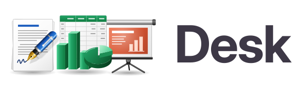
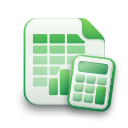

<h1 align="center">
  <picture>
    <source media="(prefers-color-scheme: dark)" srcset="data/logo/desk-logo-dark.svg">
    
  </picture>
</h1>

<p align="center">
  <a href="https://brahm.github.io/desk/">Website</a> ·
  <a href="https://github.com/brahm/desk/issues">Report a bug or ask for a feature</a>
</p>

<p align="center">
  
  
  
</p>

Desk is a free office suite for the Linux desktop, made of three apps
that share one document model:

- **Desk Writer**, for word processing and page layout
- **Desk Tables**, for spreadsheets
- **Desk Slides**, for presentations

The apps are written in Rust with GTK 4 and Libadwaita and follow the
GNOME Human Interface Guidelines. They aim for feature parity and
document compatibility with Apple iWork '09 (Pages, Numbers and Keynote
9.3). Documents are saved as OpenDocument (ODF) files, with documented
extensions for what standard ODF cannot hold.

The project is in development, starting with Desk Writer. Its text
engine, its document structure, its writing tools and its objects are
done (the first six phases of the plan;
<!-- parity -->155 of the 304 rows of its parity matrix have tests, 81 of them against what Pages itself laid out, all of them alike<!-- /parity -->):

- It opens ODT documents and Pages '09 documents, listing what they
  hold that Desk cannot keep yet, and saves as ODT.
- It pastes formatted text and pictures from other programs.
- It edits and formats text with undo and the clipboard, with
  paragraph, character and list styles, and works with a screen reader.
- It checks spelling and grammar as you type, hyphenates, and finds and
  replaces text in the whole document.
- It lays out pages as Pages does: sections with their own columns,
  margins and page numbers, facing pages, headers and footers, footnotes
  and endnotes, tables of contents, hyperlinks and bookmarks.
- It shows the pages one by one or two by two, with page thumbnails, and
  shows the document as an outline whose topics can be moved.
- It places pictures, shapes, text boxes, movies and sounds on the page
  or in the text, with masks, Instant Alpha, image adjustments, fills,
  strokes, shadows, reflections and picture frames; moves, resizes,
  turns, flips, layers, aligns, groups and locks them; and wraps the
  text around them, matching Pages page by page.
- It lays out Helvetica Neue with Desk Neue, a free font with its
  widths and kerning, so that lines break where Pages breaks them.
- `desk-convert` exports documents to PDF from the command line.

Tables and charts come next, then review and collaboration. Desk Slides
and Desk Tables have their own parity matrices, with 161 rows for
Keynote and 164 for Numbers, and start once the table and chart engine
is ready.

Desk Writer is in beta, in the Flatpak repository of Desk, which also
has a nightly branch built from `main` every night:

```sh
flatpak remote-add --if-not-exists desk https://brahm.github.io/desk/desk.flatpakrepo
flatpak install desk br.com.brahm.Desk.Writer//beta
flatpak run br.com.brahm.Desk.Writer//beta
```

Use `//nightly` in place of `//beta` for the nightly builds, which are
also a bundle in the [nightly release](https://github.com/brahm/desk/releases/tag/nightly).

Desk is built by one person working with Claude, Anthropic's AI, with
the same engineering rigor expected of any team: every feature of the
iWork '09 apps is a row of a parity matrix, and the output is compared
with PDFs made by iWork 9.3 itself.

## Building

Desk needs Rust 1.92 or later, and the development files of GTK 4.14
and Libadwaita 1.5 or later. On Debian and Ubuntu:

```sh
sudo apt install libgtk-4-dev libadwaita-1-dev
```

On Fedora:

```sh
sudo dnf install gtk4-devel libadwaita-devel
```

The build also runs `glib-compile-resources`, which comes with the GLib
development files that these packages install, to build the app icons
into the apps.

Then run an app with Cargo:

```sh
cargo run --package desk-writer
cargo run --package desk-tables
cargo run --package desk-slides
```

## Repository layout

The code is one Cargo workspace, with one crate per directory in
[crates](crates):

| Crate | Purpose |
|---|---|
| `desk-writer`, `desk-tables`, `desk-slides` | The three apps |
| `desk-ui` | Interface shared by the apps, and the only library that uses GTK |
| `desk-model` | Document model shared by the apps |
| `desk-text` | Text shaping and paragraph layout |
| `desk-layout` | Pagination and composition of pages, slides and sheets |
| `desk-render` | Display list, effects and the Cairo back end |
| `desk-table` | Table model shared by the apps |
| `desk-formula` | Formula parser, dependency graph and functions |
| `desk-chart` | Chart model and drawing |
| `desk-anim` | Slide transitions and builds |
| `desk-contacts` | Contacts for merge fields |
| `desk-odf` | OpenDocument package reader and writer, with the Desk extensions |
| `desk-iwork` | Reader for iWork '09 documents |
| `desk-filters` | Import and export filters |
| `desk-convert` | Command-line converter that runs without GTK |
| `desk-testkit` | Reference corpus, visual comparison and parity reports for the tests |

The CI checks formatting, Clippy warnings, tests and documentation, the
minimum Rust version, the licenses and advisories of dependencies (with
cargo-deny) and REUSE compliance. UI tests in [tests/ui](tests/ui) drive
Desk Writer and read it through the accessibility tree, as a screen
reader does. It also checks two dependency rules:
the MPL-2.0 libraries use no other Desk crate, and only `desk-ui` and the
apps use GTK.

## Icons and logo

The icons follow the app icon guidelines of the GNOME HIG: soft shading,
a folded corner in the color of each app, and the colors that people
know from the matching office apps (blue for the word processor, green
for the spreadsheet and orange for the presentations). They are in
[data/icons](data/icons), laid out as in the `hicolor` theme, so they
install as they are under `$prefix/share/icons/hicolor`:

| File | Use |
|---|---|
| `scalable/apps/br.com.brahm.Desk.{Writer,Tables,Slides}.svg` | Full color app icons, on a 128 px canvas |
| `symbolic/apps/br.com.brahm.Desk.{Writer,Tables,Slides}-symbolic.svg` | Symbolic app icons, on a 16 px canvas |
| `scalable/mimetypes/application-vnd.oasis.opendocument.{text,spreadsheet,presentation}.svg` | ODF documents |
| `scalable/mimetypes/application-vnd.oasis.opendocument.{text,spreadsheet,presentation}-template.svg` | ODF templates: a second sheet behind the document, the sample content faded and a dashed frame around the area to fill in |

The MIME icons use the names that shared-mime-info derives from each
MIME type, so the desktop picks them for ODF files when the icon theme
in use has none of its own. A Flatpak can only export icons whose names
start with the app ID, so a Flatpak build will have to install copies of
them under such names.

The app icons and their symbolic versions are also built into the apps
as GResources (listed in
[crates/desk-ui/resources](crates/desk-ui/resources)), so the apps show
them in their windows and About dialogs when run with Cargo, before
anything is installed.

The suite icon, a tray holding one document of each app, is in
[data/logo](data/logo) as `desk.svg`. The logo sets it next to the
"Desk" wordmark, whose letters are drawn as office charts: a bar chart
in the D, a pie chart in the e, graph paper in the s and a spreadsheet
in the k. There is a version for light backgrounds (`desk-logo.svg`)
and one for dark backgrounds (`desk-logo-dark.svg`), each also exported
as a PNG with a transparent background, 2048 px wide (`desk-logo.png`
and `desk-logo-dark.png`), for About pages, the website and store
listings. The letters, labels and figures are Inter Display converted
to outlines, so the logo does not need the font to render.

## Contributing

Every kind of help counts: trying the beta, reporting bugs, asking for the features you
miss, sending old iWork documents for the test corpus, or sending code.
Open an [issue](https://github.com/brahm/desk/issues) for any of these.
Before you open a pull request, run `ci/check-all.sh`, which runs every
check of the CI; `ci/setup-env.sh` installs what it needs.

### Translations

The interface is in English and Brazilian Portuguese. The translations
are gettext catalogs in [po](po), built into the apps, which pick the
language of the desktop. To translate Desk into another language, add
its code to `po/LINGUAS`, run `ci/update-translations.sh` to create its
catalog from `po/desk.pot`, and translate it with a PO editor such as
Gtranslator or Poedit. Run the script again when the strings of the code
change. [po/LANGUAGES.md](po/LANGUAGES.md) lists the languages that Desk
will support, and when.

## Website

The website at <https://brahm.github.io/desk/> lives in [site](site),
and shares GitHub Pages with the future Flatpak repository; see
[site/README.md](site/README.md).

## License

Desk uses two licenses:

- The applications are licensed under the GNU General Public License,
  version 3 or (at your option) any later version (GPL-3.0-or-later).
  See [LICENSE](LICENSE).
- The file format libraries (`desk-odf`, `desk-iwork` and
  `desk-formula`) are licensed under the Mozilla Public License 2.0
  (MPL-2.0), so that other programs can reuse them to read and write
  the same formats.

The full license texts are in [LICENSES](LICENSES). The repository
follows the [REUSE](https://reuse.software/) specification: source files
carry SPDX headers, and [REUSE.toml](REUSE.toml) covers files that
cannot.

Desk is not affiliated with or endorsed by Apple Inc. iWork, Pages,
Numbers and Keynote are trademarks of Apple Inc.
