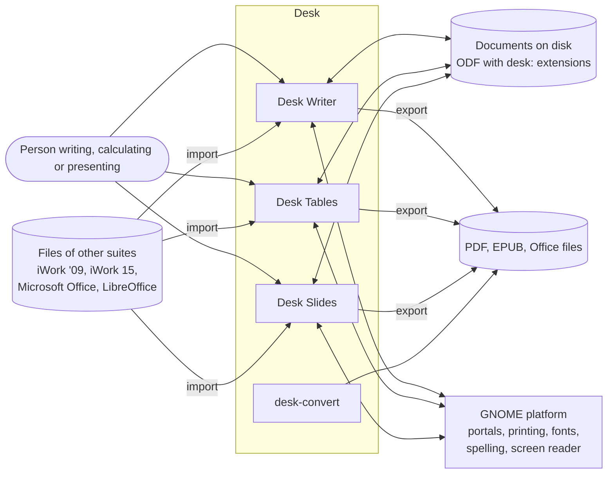
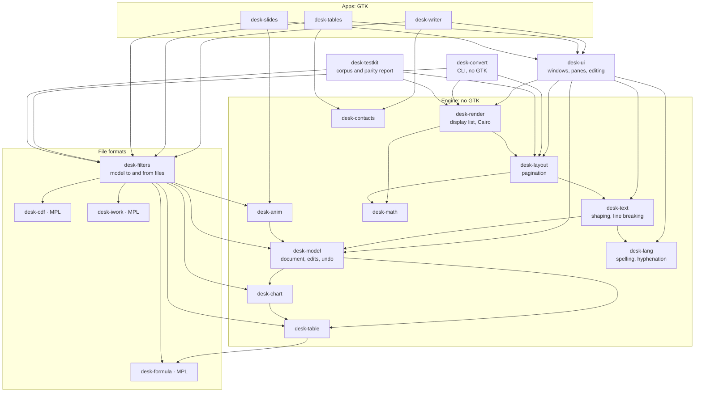
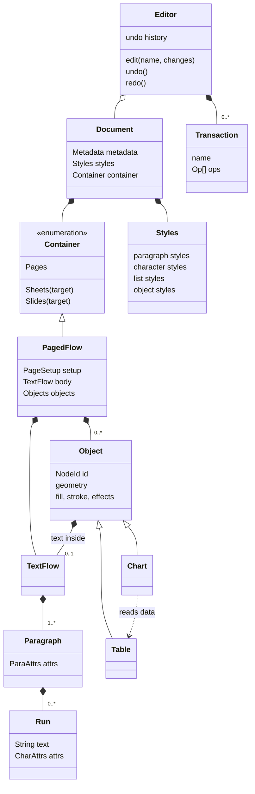
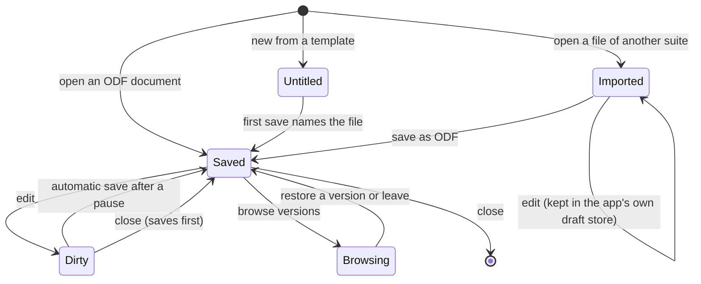
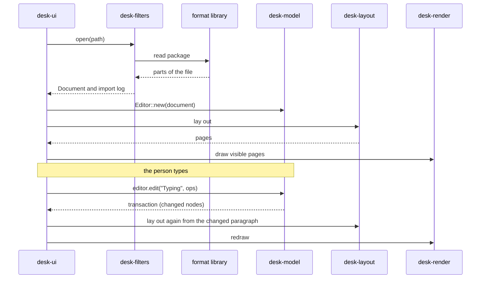
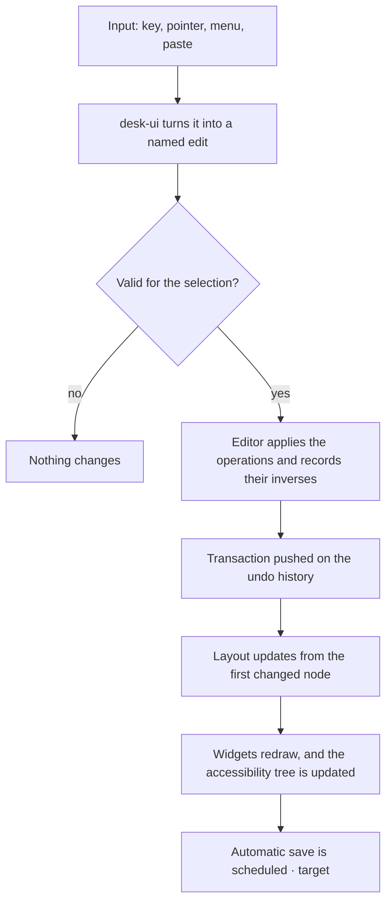
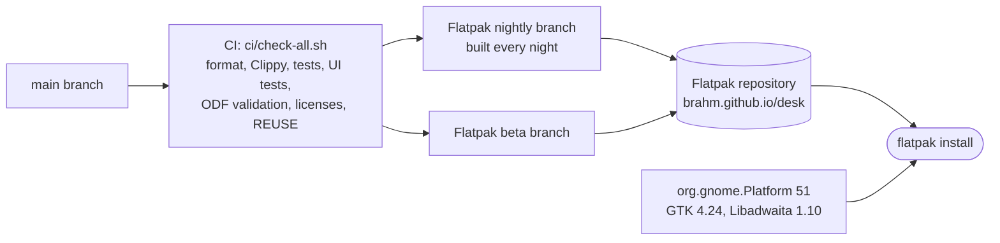

# Architecture

How Desk is put together: who uses it and what it talks to, the crates and
what each may depend on, the document model, the life of a document and
the path of an edit. Diagrams are Mermaid, so GitHub draws them and an
agent can read and change them as text.

Each section says whether it describes **today** (commit `0888aa9`,
2026-11-16) or the **target** of [goals.md](goals.md). Where they differ,
the roadmap phase that closes the gap is named.

## 1. Context

Today and target. Desk is three desktop apps and a command-line converter.
It has no server and no account: everything in scope works offline (D-004).



## 2. Use cases

Target. The use cases every app shares; each app adds its own (sections,
formulas, builds) in its matrix.

```mermaid
flowchart TB
    author([Author])
    reviewer([Reviewer])
    presenter([Presenter])
    subgraph Desk
        create(Create from a template)
        open(Open or import a file)
        edit(Edit text, tables, charts and objects)
        style(Format with styles and the Inspector)
        versions(Browse and restore versions)
        review(Comment and track changes)
        export(Export or print)
        present(Play a presentation)
    end
    author --> create & open & edit & style & versions & export
    reviewer --> open & review
    presenter --> open & present
    edit -. saved automatically .-> versions
```

## 3. Crates

Today. One Cargo workspace; an arrow means "depends on". The CI enforces
two rules (`ci/check-deps.sh`): only `desk-ui` and the three apps use GTK,
and the MPL-2.0 libraries (`desk-odf`, `desk-iwork`, `desk-formula`) use no
other Desk crate, so that other programs can reuse them.



| Layer | Rule |
| --- | --- |
| File format libraries | Know XML, ZIP and the format. They do not know the model. |
| `desk-filters` | The only place that turns a format into the model and back. Every import returns a log of what it could not keep. |
| `desk-model` | Holds every change as an operation with an inverse. Nothing outside it mutates a document. |
| `desk-text`, `desk-layout`, `desk-render` | Pure functions of the model: the same document gives the same pages, on screen, in PDF and in tests. |
| `desk-ui` | The only library that uses GTK. Widgets read the model and send edits; they hold no document state of their own. |

What the target adds, each in the phase named in [roadmap.md](roadmap.md):

| Addition | Where it goes |
| --- | --- |
| Readers of current iWork files | A new MPL crate beside `desk-iwork`, under the rules of D-011 |
| Readers and writers of `.docx`, `.xlsx`, `.pptx` | A new MPL crate for OOXML packages, and filters in `desk-filters` |
| ODS and ODP | `desk-odf` and `desk-filters`, with the sheet and slide containers of the model |
| Automatic saving and versions | `desk-model` snapshots, a store in `desk-filters`, the interface in `desk-ui`; replaces `recovery.rs` |
| Document tabs, the M+ window | `desk-ui`; replaces `format_bar.rs`, `bottom_bar.rs` and the sheet list of the sidebar |
| Live links between documents | `desk-model` (a link node with a source and a range), refreshed by `desk-filters` |
| Transition and build engine | `desk-anim`, today a stub |

## 4. Document model

Today for Writer; the sheet and slide containers are the target. One model
serves the three apps, so an object copied from one to another stays the
same object.



- Every node has a stable `NodeId`.
- Formatting is set as optional attributes on styles and on the text and
  resolved through the inheritance of the styles.
- Cloning a `Document` is cheap and gives a snapshot, because the content
  lives in persistent structures. Versions (target) are snapshots kept on
  disk.

## 5. Life of a document

Target (D-001: saving is automatic, with versions). Today the app saves on
command and keeps a recovery draft; the base phase of the roadmap replaces
that.



## 6. From a file to the screen, and an edit

Today.



## 7. An edit, step by step

Today. Every change, from a key press to a paste from another app, takes
this path, which is what makes undo complete.



## 8. Distribution

Today. Flatpak on the GNOME 51 runtime is the supported way to install
Desk (D-013).



## Where to read next

- What each feature must do: [`corpus/inventory`](../corpus/inventory/README.md)
  and the parity matrices in [`corpus`](../corpus/README.md).
- Where each control sits in the window: [`interface`](interface/README.md)
  and the chosen proposal in [`interface/proposals`](interface/proposals/README.md).
- How a feature is stored: [odf-extensions.md](odf-extensions.md).
- What comes when: [roadmap.md](roadmap.md).
