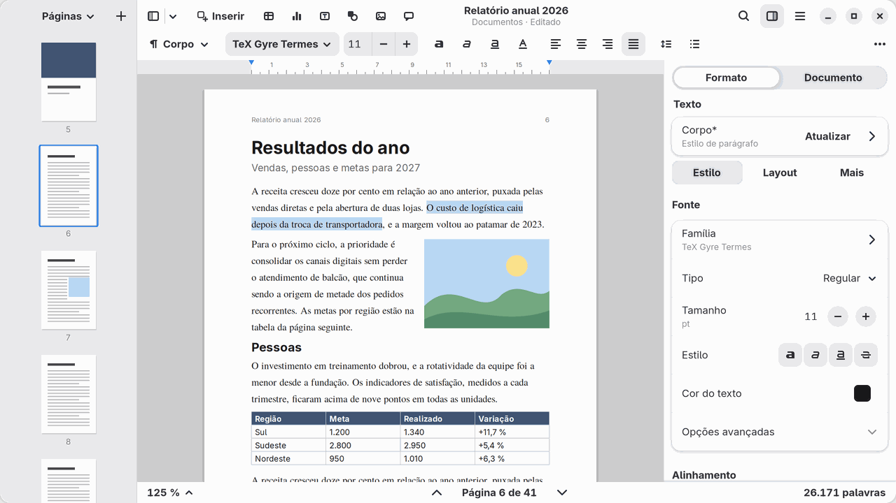
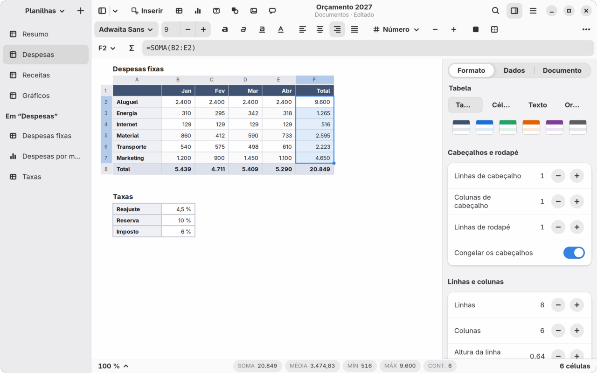
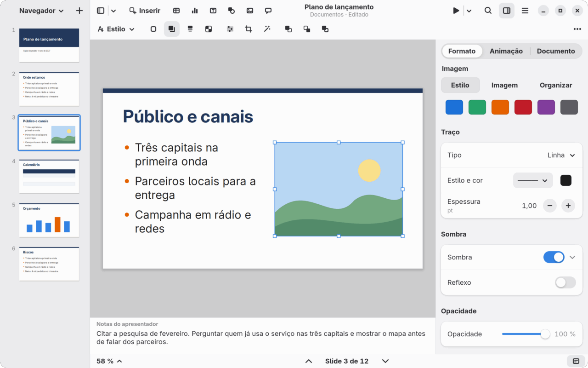
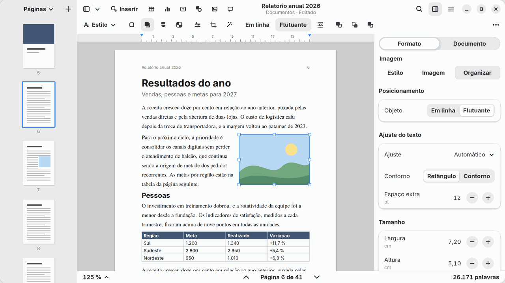
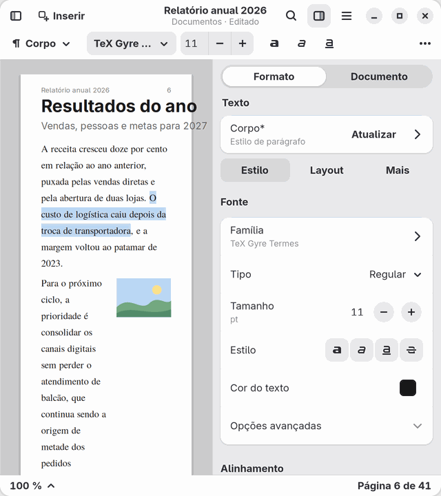
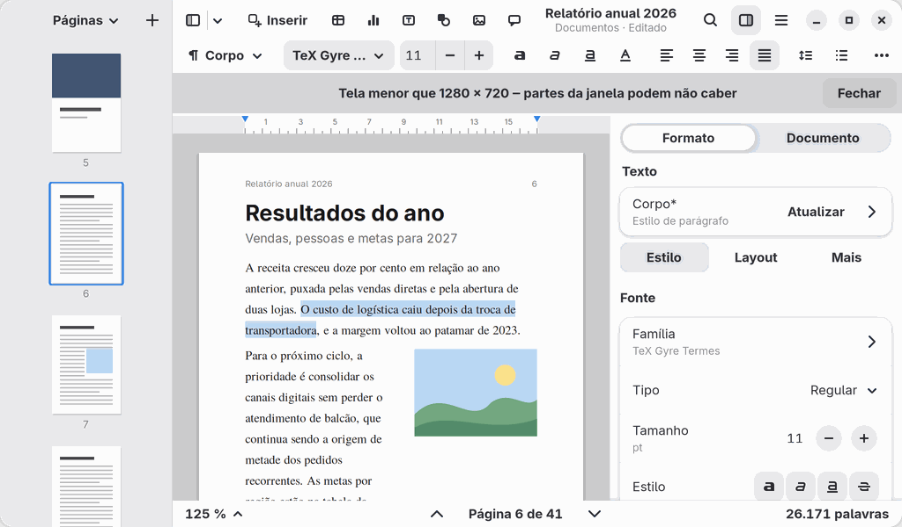

# A interface do Desk

*The interface plan of Desk Writer, Desk Tables and Desk Slides, in
Portuguese like the parity matrices: the layout chosen on 2026-11-14, the
inventory of its components, the place of every command of iWork '09 in
it, and the order of the work.*

Este diretório diz como é a janela dos três aplicativos do Desk e o que
falta escrever para chegar nela. O objetivo é paridade de funções com o
iWork '09, e não de interface: a janela segue a HIG do GNOME e os
componentes da Libadwaita 1.10 (GNOME 51), e guarda do iWork o que deixa
em casa quem vem dele, isto é, os nomes, a ordem das coisas e o Inspetor.

| Arquivo | O que é |
| --- | --- |
| [`componentes.tsv`](componentes.tsv) | Os 207 componentes da interface, um por linha: o widget que o desenha, o que faz, o que era no iWork '09, o que é no iWork de hoje, o atalho e o estado no Desk Writer. É o inventário do que implementar. |
| [`iwork-para-desk.tsv`](iwork-para-desk.tsv) | Os 933 comandos, botões, painéis e janelas do Pages 4.3, do Numbers 2.3 e do Keynote 5.3, lidos na máquina virtual de referência, cada um com o lugar dele no Desk. |
| [`janelas/`](janelas) | Oito janelas dos mockups, em PNG. |
| [`mockups/`](mockups) | O código que desenha os mockups com o GTK e a Libadwaita de verdade, e o catálogo de onde sai o inventário. |
| [`iwork_map.py`](iwork_map.py) | As regras que levam cada item do iWork ao lugar dele no Desk. |

As três matrizes de paridade em [`corpus/`](../../corpus/README.md) dizem
o que cada aplicativo tem de fazer. Este diretório diz onde cada coisa
fica na janela. A coluna `gnome` das matrizes aponta para cá nas linhas
que a interface mudou.

## A decisão

Foram desenhadas três versões da janela para os três aplicativos. A
versão A ficava perto do iWork '09, com muitos botões na barra de
cabeçalho e o Inspetor de ícones. A versão C ficava perto dos aplicativos
do GNOME, sem barra de formatação. Em 14/11/2026 foi escolhida a versão
B, a equilibrada, que é a única descrita daqui em diante. O código das
outras duas continua em `mockups/`, como registro.

O que pesou na escolha, com a janela em 1280 × 720:

| | A | B | C |
| --- | --- | --- | --- |
| Controles na barra de cabeçalho do Writer | 6 | 11 | 6 |
| Controles na barra de formatação do Writer | 17 | 11 | não tem |
| Altura das barras acima do documento | 88 px | 86 px | 46 px |
| Largura do Inspetor | 290 a 367 px | 332 px | 332 px |
| Componentes do Writer que já existem, mudam ou são novos | 39, 5 e 2 | 22, 20 e 9 | 5, 13 e 9 |

A versão B mantém à vista o que o iWork mantinha (inserir objetos e
formatar texto com um clique) e arruma o resto como a HIG pede.

## A tela mínima

O Desk é feito para computadores de mesa, notebooks e tablets. A tela
mínima é de **1280 × 720 pixels** (720p), em pixels lógicos, isto é,
depois da escala da tela: uma tela de 2560 × 1440 em 200 % conta como
1280 × 720, e uma de 1920 × 1080 em 200 % conta como 960 × 540. Num
tablet, vale a tela deitada. Celulares e telas menores que a mínima não
têm suporte: o Desk abre nelas e continua funcionando, mas avisa na
abertura que a experiência pode ser prejudicada (GNM-14, NGNM-14,
KGNM-15). A janela abre com 1280 × 720.

A HIG pede que todo aplicativo funcione numa tela de 1024 × 600. O Desk
pede mais, porque uma página, uma barra lateral e o Inspetor lado a lado
precisam de 1280 px. Em 1024 × 600 a janela ainda abre inteira, com o
aviso (veja abaixo), mas não é nessa tela que as decisões de desenho são
tomadas nem conferidas.

### A conferência das telas

Todas as 37 cenas dos mockups, das três versões, foram refeitas em
1280 × 720, e o tamanho mínimo de cada janela foi medido com o GTK
(`gtk_widget_measure`), sem pontos de quebra. Nenhuma passa de
1280 px de largura nem de 490 px de altura, de modo que todas cabem na
tela mínima, mesmo maximizadas sob a barra superior do GNOME.

| Cenas da versão B | Largura mínima | Altura mínima |
| --- | --- | --- |
| Writer (texto, imagem, forma, Documento, popovers e menus) | 921 a 953 px | 258 a 352 px |
| Writer com a busca e a substituição abertas | 953 px | 490 px |
| Tables (Formato, Dados, gráfico, fórmula, Documento) | 921 a 1046 px | 298 a 330 px |
| Slides (objeto, slide, transição, Animação, Documento) | 991 px | 248 a 290 px |
| Mesa de luz do Slides | 1018 px | 216 px |
| Seletor de modelos | 622 px | 160 px |
| Diálogos (Preferências, atalhos, busca de comandos, fechar) | 953 px | 352 px |

A conferência achou quatro coisas que o plano passa a pedir:

- **O zoom ao abrir.** Com a barra lateral (196 px) e o Inspetor
  (332 px) abertos, sobram 752 px para o documento em 1280 px. Uma página
  A4 em 100 % tem 794 px, e uma Carta, 816 px, então a página não cabe
  inteira. O Writer abre o documento com o zoom que faz a página caber na
  largura, até 100 %, como o Ajustar à largura do Pages. Os mockups
  desenham a página menor do que ela é, e o rótulo de zoom deles não é
  uma medida.
- **Abas do Inspetor com quatro nomes.** Em 332 px, as abas Tabela,
  Célula, Texto e Organizar, e Gráfico, Eixo, Séries e Organizar, saem
  cortadas (Ta…, Cél…). A fase 7 do Writer resolve isso antes de desenhar
  essas abas, com nomes que caibam ou com o Inspetor um pouco mais largo
  quando há quatro abas.
- **A barra de formatação do Tables** precisa de 1046 px, mais que os
  1000 px em que a do Writer se recolhe. O ponto de quebra da barra de
  formatação é medido por aplicativo: no Tables, cerca de 1060 px.
- **Meia tela.** Com duas janelas lado a lado na tela mínima, cada uma tem
  640 px. O Inspetor fica ao lado da página até 520 px e deixa uns 300 px
  para ela, que abre com o zoom que caber.

## A janela



A janela tem as mesmas sete regiões nos três aplicativos.

| Região | O que tem | Widget |
| --- | --- | --- |
| Barra lateral de navegação | Painel da altura da janela, à esquerda, com cabeçalho próprio. O botão de conteúdo troca o que ela mostra, e o botão Adicionar cria uma página, uma planilha ou um slide. | `AdwOverlaySplitView`, `AdwToolbarView`, `AdwSidebar` |
| Barra de cabeçalho | Só o que vale para a janela inteira. No início, o botão Barra lateral com o menu Visualização, o menu Inserir e os botões Tabela, Gráfico, Caixa de texto, Forma, Mídia e Comentário. No centro, o título. No fim, Buscar, Inspetor e o menu principal. O Slides tem ainda o botão Reproduzir. Não é personalizável. | `AdwHeaderBar`, `AdwSplitButton`, `GtkMenuButton` |
| Barra de formatação | Barra fina que muda com a seleção e mostra só o essencial. Termina no menu Mais, que guarda o resto e Mostrar no Inspetor. O menu Visualização a esconde. | `GtkBox` com a classe `toolbar` |
| Barra de fórmulas | Só no Tables, sob a barra de formatação: célula ativa, botão Função e o conteúdo da célula. Cancelar e Aceitar aparecem durante a edição. | `GtkBox`, `GtkEntry` |
| Documento | A página com a régua, a tela da planilha ou o slide com as notas do apresentador. | `GtkScrolledWindow` e o widget do documento |
| Inspetor | Painel utilitário de 332 px à direita, um só, que mostra o que a seleção tem. | `AdwOverlaySplitView`, `AdwToggleGroup`, `AdwInlineViewSwitcher`, `AdwPreferencesGroup` |
| Barra inferior | Barra fina: zoom no início, posição no centro e, no fim, a contagem de palavras (Writer), as fichas do cálculo instantâneo (Tables) ou o botão das notas (Slides). | `GtkBox` com a classe `toolbar` |

Avisos de importação aparecem numa faixa (`AdwBanner`) sobre o documento,
e a busca é uma barra sob a barra de cabeçalho, as duas como o Desk Writer
já faz. O aviso de tela pequena usa uma faixa igual.





### A barra lateral de navegação

| Aplicativo | Páginas que o botão de conteúdo mostra | O que o botão Adicionar cria |
| --- | --- | --- |
| Writer | Páginas (miniaturas), Estilos, Comentários, Resultados da busca | Uma página do modelo |
| Tables | Planilhas (com as tabelas e os gráficos de cada uma), Estilos de tabela, Comentários, Resultados da busca, Lista de fórmulas | Uma planilha |
| Slides | Navegador, Tópicos, Slides mestres, Comentários, Resultados da busca | Um slide, a partir de um slide mestre |

F9 mostra e esconde a barra. A página Estilos é o que o Pages tinha na
gaveta de estilos, e Resultados da busca é a barra lateral de busca do
Pages. A mesa de luz do Slides não é uma página da barra: ocupa a área do
documento.

### O Inspetor

O Inspetor tem dois níveis. O primeiro é um seletor de substantivos
curtos. O segundo são as abas do que está selecionado, com um título que
diz o que é (Texto, Imagem, Forma, Tabela, Gráfico, Slide). Quando só há
uma aba, o seletor de abas some.

| Primeiro nível | Seleção | Abas |
| --- | --- | --- |
| Formato | Texto | Estilo, Layout, Mais |
| Formato | Imagem | Estilo, Imagem, Organizar |
| Formato | Forma ou caixa de texto | Estilo, Texto, Organizar |
| Formato | Tabela | Tabela, Célula, Texto, Organizar |
| Formato | Gráfico | Gráfico, Eixo, Séries, Organizar |
| Formato (Slides) | Nada | Slide: layout, aparência e fundo |
| Dados (Tables) | Tabela | Ordem, Filtro, Categorias |
| Animação (Slides) | Objeto | Entrada, Ação, Saída |
| Animação (Slides) | Nada | Transição do slide |
| Documento (Writer) | Qualquer uma | Documento, Seção, Info |
| Documento (Tables) | Qualquer uma | Planilha, Info |
| Documento (Slides) | Qualquer uma | Documento, Áudio, Info |

Os dez painéis do Inspetor do iWork '09 cabem nessas abas: Texto virou
Estilo, Layout e Mais; Gráfico (Graphic) virou Estilo; Métricas e Ajuste
viraram Organizar; Link virou um popover; QuickTime aparece quando há som
ou filme selecionado. As propriedades usam as linhas prontas da
Libadwaita (`AdwActionRow`, `AdwComboRow`, `AdwSpinRow`, `AdwSwitchRow`,
`AdwExpanderRow`) dentro de `AdwPreferencesGroup`.



### A barra de formatação

| Seleção | Controles |
| --- | --- |
| Texto (Writer) | Estilo de parágrafo, fonte, tamanho, negrito, itálico, sublinhado, cor do texto, alinhamento, espaçamento entre linhas, lista, Mais |
| Objeto | Estilo, traço, sombra, reflexo, opacidade, Ajustar imagem, Editar máscara, Alfa instantâneo, Frente, Trás, Organizar, Mais. No Writer entram Em linha ou flutuante e Ajuste do texto. |
| Célula (Tables) | Fonte, tamanho, negrito, itálico, sublinhado, cor do texto, alinhamento, formato de dados, menos e mais casas decimais, preenchimento, bordas, Mais |
| Gráfico | Tipo de gráfico, Editar dados, Mais |
| Slide, sem nada selecionado | Slide mestre, fundo, transição, Pular este slide, Mais |

Fontes e Cores são popovers presos ao botão da fonte e aos botões de cor,
como o Desk Writer já faz, no lugar das janelas flutuantes do iWork.

### Os menus

A barra de menus do iWork tinha de 205 a 225 comandos por aplicativo. No
Desk eles ficam em cinco lugares, e a busca de comandos acha qualquer um
pelo nome, inclusive pelo nome que a Apple dava em português.

| Menu | Onde fica | O que tem |
| --- | --- | --- |
| Menu principal | Fim da barra de cabeçalho (F10) | Doze itens: Novo documento, Abrir, Abrir recente, Salvar, Salvar como, Exportar, Imprimir, Buscar comandos, Preferências, Atalhos de teclado, Ajuda, Sobre |
| Visualização | Seta do botão Barra lateral | As páginas da barra lateral, régua, barra de formatação, layout, invisíveis, tela cheia e zoom |
| Inserir | Botão Inserir | O que o menu Inserir do iWork tinha além dos objetos: quebras, campos, nota de rodapé, sumário, marcador, link, caracteres especiais, Escolher |
| Mais | Fim da barra de formatação | O que era do menu Formatar e não cabe na barra enxuta |
| Organizar | Barra de formatação do objeto e menu de contexto | Ordem, alinhar, distribuir, espelhar, agrupar, travar |

Editar vira atalhos e menu de contexto. Os menus Tabela (Numbers), Slide e
Reproduzir (Keynote) viram o menu de contexto da tabela, o do navegador de
slides e o menu do botão Reproduzir. Janela e os comandos Ocultar são do
GNOME. Compartilhar some: o iWork.com foi encerrado, e exportar e enviar
por e-mail ficam em Exportar.

### Janelas menores que a tela

A tela mínima é de 1280 × 720, mas a janela pode ser menor que a tela,
como quando fica lado a lado com outra. Os pontos de quebra cuidam disso,
e não de celulares:

| Largura da janela | O que muda |
| --- | --- |
| Abaixo de 1000 px (Writer), de cerca de 1060 px (Tables) | A barra de formatação se recolhe, e o resto vai para o menu Mais |
| Abaixo de 720 px | A barra lateral de navegação vira sobreposição, e os botões de objeto entram no menu Inserir |
| Abaixo de 520 px | O Inspetor também vira sobreposição: fecha e volta por cima do documento |

São `AdwBreakpoint` da janela. Não há leiaute de celular nem folha
inferior: abaixo de 520 px a janela continua usável, sem conferência. O
estilo escuro e o de alto contraste vêm prontos da Libadwaita.



### O aviso de tela pequena

Quando uma janela abre num monitor menor que 1280 × 720, uma faixa
(`AdwBanner`) sob as barras do alto diz:

> Tela menor que 1280 × 720 ‒ partes da janela podem não caber

O botão **Fechar** esconde a faixa. Nada é bloqueado e não há diálogo: a
HIG põe numa faixa um estado que dura, como esse, e um toast sumiria
antes de ser lido.

- **Quando.** Ao abrir a primeira janela de cada aplicativo, depois que
  ela aparece, com o monitor em que ela está
  (`gdk_display_get_monitor_at_surface`). A medida é a geometria do
  monitor, que o GTK já dá em pixels lógicos; vale largura menor que
  1280 ou altura menor que 720, então um tablet em pé também recebe o
  aviso.
- **Até quando.** Fechada, a faixa não volta até o aplicativo abrir de
  novo. Não há preferência para calar o aviso, e mover a janela para
  outro monitor não o mostra outra vez.
- **Com outras faixas.** Fica acima da faixa de avisos de importação; as
  duas podem aparecer juntas.
- **Testes.** A regra é uma função da geometria (largura e altura) e é
  testada sozinha; o teste da interface abre a janela numa tela virtual
  de 1024 × 600 e confere a faixa pela árvore de acessibilidade.



## Atalhos

Três regras, nesta ordem:

1. Onde o GNOME tem um atalho padrão, ele vale.
2. Onde o GNOME não diz nada, vale o atalho do iWork, com Ctrl no lugar
   de ⌘ e Alt no lugar de ⌥.
3. Onde os dois colidem, o comando do iWork ganha um atalho novo, que
   aparece no diálogo de atalhos (Ctrl+?) e na busca de comandos.

Os atalhos do iWork foram lidos dos menus dos três aplicativos na máquina
virtual.

| Comando | iWork '09 | Desk | Regra | Observação |
| --- | --- | --- | --- | --- |
| Novo, Abrir, Salvar, Imprimir, Fechar, Desfazer, Copiar, Colar, Selecionar tudo, Negrito, Itálico, Sublinhado, Buscar | ⌘ e a letra | Ctrl e a mesma letra | 1 | Coincidem |
| Desmarcar tudo | ⇧⌘A | Ctrl+Shift+A | 1 | É o que a HIG dá a esse comando |
| Substituir | No painel de ⌘F | Ctrl+H | 1 | A busca é uma barra |
| Tela cheia | ⌃⌘F | F11 | 1 | |
| Ampliar, reduzir, tamanho real | ⌘> e ⌘< | Ctrl++, Ctrl+− e Ctrl+0 | 1 | Aumentar e diminuir a fonte, que o iWork tinha em ⌘+ e ⌘−, ficam no campo de tamanho |
| Barra lateral | ⌥⌘P (miniaturas) | F9 | 1 | Vale para páginas, planilhas e slides |
| Menu principal e atalhos de teclado | Não se aplica | F10 e Ctrl+? | 1 | |
| Colar e manter o estilo do destino | ⌥⇧⌘V | Ctrl+Shift+V | 1 | |
| Inserir, Escolher | ⇧⌘V | Ctrl+Alt+P | 3 | Ctrl+Shift+V ficou com colar sem formatação |
| Inspetor | ⌥⌘I | Ctrl+Alt+I | 2 | |
| Régua, barra de formatação, layout, invisíveis | ⌘R, ⇧⌘R, ⇧⌘L, ⇧⌘I | Ctrl+R, Ctrl+Shift+R, Ctrl+Shift+L, Ctrl+Shift+I | 2 | |
| Fontes, Cores, estilos | ⌘T, ⇧⌘C, ⇧⌘T | Ctrl+T, Ctrl+Shift+C, Ctrl+Shift+T | 2 | Fontes e Cores abrem como popovers, e os estilos, na barra lateral |
| Estilos de parágrafo | F1 a F8 | Ctrl+1 a Ctrl+8 | 3 | O GNOME reserva F1, F9 e F10 |
| Duplicar, Travar, Agrupar, Desagrupar | ⌘D, ⌘L, ⌥⌘G, ⌥⇧⌘G | Ctrl+D, Ctrl+L, Ctrl+Alt+G, Ctrl+Shift+Alt+G | 2 | |
| Trazer para a frente, Enviar para trás | ⇧⌘F, ⇧⌘B | Ctrl+Shift+] e Ctrl+Shift+[ | 3 | É o que o Desk Writer já usa. Uma camada por vez: Ctrl+] e Ctrl+[ |
| Resultados da busca na barra lateral | ⌥⌘F | Ctrl+Alt+F | 2 | |
| Máscara | ⇧⌘M | Ctrl+Shift+M | 2 | |
| Buscar comandos | ⇧⌘? (busca do menu Ajuda) | Ctrl+/ | 3 | Nos campos de texto do GTK, Ctrl+/ seleciona tudo. No GTK 4.24.1 o atalho do aplicativo vence, e selecionar tudo continua em Ctrl+A |
| Reproduzir a apresentação | ⌥⌘P | F5 | 3 | Ctrl+Alt+P já é Escolher, e F5 é o costume em apresentações no Linux |
| Novo slide | ⇧⌘N | Ctrl+M | 3 | Ctrl+Shift+N já é Nova janela no Desk |
| Pular este slide | Sem atalho | Ctrl+Shift+H | 2 | Igual ao Keynote de hoje |
| Linha acima ou abaixo, coluna antes ou depois | ⌥ e as setas | Alt e as setas | 2 | No Tables |
| Lista de fórmulas | ⌥⌘F | Ctrl+Shift+F | 3 | Ctrl+Alt+F já abre os resultados da busca. Ctrl+Shift+F guarda o F do Numbers e está livre no Desk e no GNOME |

Os atalhos que eram propostas foram confirmados em 14/11/2026.

## Práticas da HIG que a interface segue

- **Barra de cabeçalho.** Só o que vale para a janela inteira. Botões com
  ícone têm dica e nome acessível, e o rótulo aparece onde o ícone sozinho
  não basta, como em Inserir.
- **Menus.** O menu principal fica no fim da barra de cabeçalho e termina
  em Preferências, Atalhos de teclado, Ajuda e Sobre. Os submenus têm um
  nível só.
- **Barra lateral e painel utilitário.** A navegação fica à esquerda. O
  Inspetor é um painel utilitário à direita, que não navega, só mostra o
  que a seleção tem.
- **Seletores de visualização.** Rótulos curtos, substantivos, de tamanho
  parecido: Formato, Dados, Animação, Documento.
- **Listas em caixa.** As propriedades usam as linhas da Libadwaita, e os
  interruptores têm o rótulo na linha.
- **Popovers pequenos.** Fontes, Cores, formas, mídia, traço e opacidade
  abrem presos ao botão. O que o iWork abria em janelas flutuantes ficou
  dentro da janela.
- **Avisos na medida certa.** Faixa para o que afeta o documento, toast
  para o que não pede resposta, e o diálogo de alerta do GNOME para fechar
  com alterações (Descartar, Cancelar, Salvar).
- **Janela que se adapta.** Tela mínima de 1280 × 720, com um aviso
  abaixo dela; pontos de quebra para meia tela e janelas menores (720 e
  520 px), estilo escuro e alto contraste.
- **Teclado.** Os atalhos padrão do GNOME têm prioridade, e todo comando
  aparece no diálogo de atalhos e na busca de comandos.
- **Texto da interface.** Em português, só a primeira letra maiúscula e os
  termos do glossário do GNOME: Buscar, Visualização, Formato, Travar,
  Tópicos, Planilha. Os nomes do iWork ficam quando não há conflito:
  Inspetor, Navegador, Mesa de luz, Alfa instantâneo.

## Do iWork para o Desk

[`iwork-para-desk.tsv`](iwork-para-desk.tsv) tem uma linha para cada
comando de menu, item da barra de ferramentas, modo da barra de
formatação, aba do Inspetor, painel de preferências e janela dos três
aplicativos, com o nome em inglês, o nome que a Apple dava em português,
o atalho, o lugar no Desk e o componente que o recebe.

| | Pages 4.3 | Numbers 2.3 | Keynote 5.3 |
| --- | --- | --- | --- |
| Comandos de menu | 225 | 205 | 208 |
| Itens que a barra de ferramentas aceita | 48 | 39 | 50 |
| Modos da barra de formatação | 18 | 19 | 17 |
| Abas do Inspetor | 19 | 12 | 19 |
| Painéis de preferências | 3 | 3 | 6 |
| Janelas, folhas e painéis | 19 | 9 | 14 |
| **Total** | **332** | **287** | **314** |

A coluna `como` diz o que aconteceu com cada um:

| | Pages | Numbers | Keynote | Total |
| --- | --- | --- | --- | --- |
| `igual`: mesmo lugar e mesma forma | 62 | 50 | 50 | 162 |
| `adaptado`: outro lugar ou outra forma, do jeito do GNOME | 247 | 215 | 231 | 693 |
| `sistema`: o GNOME cuida (janelas, ocultar o aplicativo) | 6 | 6 | 6 | 18 |
| `fora`: fora do escopo | 17 | 16 | 27 | 60 |

O que fica de fora: o iWork.com, os envios para o iDVD, o iPhoto, o
iTunes, o GarageBand, o YouTube e o iPod, o Keynote Remote, as ações do
Automator, os tutoriais e o registro da Apple, a personalização da barra
de ferramentas e o comando Novo Inspetor.

O inventário na máquina virtual também achou comandos que os manuais não
citam e as matrizes não tinham. Eles entraram nas matrizes com os
prefixos `VMI`, `NVMI` e `KVMI`: Desmarcar tudo, Reaplicar padrões à
seleção, as linhas de conexão das caixas vinculadas, Redefinir texto e
alças da forma, a quebra de coluna no texto do Tables e do Slides, as
animações obsoletas, a geometria do gráfico nos slides mestres e Ajustar
à janela.

## Os componentes

[`componentes.tsv`](componentes.tsv) tem 207 linhas. Cada uma é uma peça
que aparece nos mockups, com o tipo do widget lido do próprio mockup.

| Seção | Já existe | Muda | Novo |
| --- | --- | --- | --- |
| Janela e barra de cabeçalho | 5 | 8 | 3 |
| Barra lateral | 1 | 1 | 4 |
| Barra de formatação | 12 | 6 | 18 |
| Barra de fórmulas (Tables) | | | 7 |
| Documento | 2 | | 4 |
| Inspetor | | 37 | 9 |
| Inspetor do Tables | | | 25 |
| Inspetor do Slides | | | 18 |
| Barra inferior | 4 | 2 | 3 |
| Busca, avisos e comandos | 9 | 1 | 4 |
| Popovers | 6 | 1 | 3 |
| Seletor de modelos e diálogos | 7 | 6 | 1 |
| **Total** | **46** | **62** | **99** |

O estado é medido contra o Desk Writer de hoje: `existe` já está lá,
`muda` está lá de outra forma e `novo` falta escrever. O Writer usa 137
dos 207 componentes (46 existem, 62 mudam e 29 são novos), o Tables usa
122 e o Slides, 112. Tudo o que é comum aos três fica em `desk-ui`.

Dos componentes da Libadwaita que a interface pede, o Desk Writer ainda
não usa um: `AdwSplitButton`. A folha inferior (`AdwBottomSheet`), que
servia a celulares, saiu com a tela mínima de 1280 × 720. Os mais novos da
lista, `AdwSidebar` (1.9), `AdwToggleGroup` e `AdwInlineViewSwitcher`
(1.7), já estão em `desk-ui` e passam a ter um papel maior.

## A ordem do trabalho

O Desk Writer muda para a interface B antes das tabelas e dos gráficos
(fase 7 do roteiro), porque a fase 7 acrescenta abas ao Inspetor e modos à
barra de formatação, e porque o Tables e o Slides começam pela janela.
São sete etapas, cada uma um pull request que deixa o aplicativo
funcionando.

| Etapa | O que faz | Linhas das matrizes |
| --- | --- | --- |
| 1. Esqueleto da janela (feita) | Barra lateral de navegação da altura da janela, com o botão de conteúdo e o botão Adicionar; Inspetor como painel utilitário; os dois pontos de quebra | GNM-12, GNM-01 |
| 2. Barra de cabeçalho e menus (feita) | Botão Barra lateral com o menu Visualização, Inserir e os seis botões de objeto, o popover de mídia, o menu principal de doze itens, a busca de comandos e o aviso de tela pequena | INT-11, INT-14, GNM-10, GNM-14 |
| 3. Barra de formatação enxuta (feita) | As variantes de texto e de objeto, o menu Mais e o menu Organizar | INT-12 |
| 4. Inspetor em dois níveis (feita) | Formato e Documento, o título do contexto, as abas de texto, imagem e forma, e o Inspetor sobreposto abaixo de 520 px | INT-13 |
| 5. Páginas da barra lateral (feita) | Estilos no lugar da gaveta, Comentários e Resultados da busca | INT-18, TXT-13 |
| 6. Barra inferior (feita) | Zoom, posição com Ir para e Navegar por, contagem e seleção | GNM-13, INT-07, INT-19, DOC-20 |
| 7. Comandos e atalhos (feita) | Os quatro comandos do inventário, os atalhos confirmados, o diálogo de atalhos, as traduções e os testes pela árvore de acessibilidade | VMI-01 a VMI-04 |

Oito linhas que já têm testes mudam de forma com a interface B e ficam
reabertas até a etapa que as refaz: INT-07, INT-11, INT-14, INT-18,
INT-19, DOC-20, TXT-13 e GNM-01. A etapa 1 refez GNM-01 para a tela
mínima de 1280 × 720: abaixo de 720 px, como em meia tela, a barra
lateral cobre as páginas; abaixo de 520 px o Inspetor fecha e volta por
cima delas. O botão Adicionar da barra lateral insere, por enquanto, uma
página em branco ou uma quebra de seção; as páginas do modelo chegam com
a fase 9 (INT-06). A etapa 2 refez INT-11 e INT-14: a barra de
cabeçalho tem o botão Barra lateral, Inserir e os seis objetos, e o
Navegador de mídia mora no popover do botão Mídia. Tabela e Gráfico ficam
desativados até a fase 7 do Writer, e Comentário até a etapa 5. O menu
principal tem nove dos doze itens: Exportar, Imprimir e Ajuda entram
quando essas funções existirem. Abaixo de 720 px os objetos saem da barra
e entram no menu Inserir. A etapa 3 deixou a barra de formatação enxuta (INT-12). Para
texto, ela tem estilo de parágrafo, fonte, tamanho, negrito, itálico,
sublinhado, cor, alinhamento, espaçamento entre linhas e lista. Estilo de
caractere, tachado, colunas, Copiar e Colar estilo e Mostrar no Inspetor
ficam no menu Mais, e abaixo de 1000 px o alinhamento, o espaçamento e a
lista também vão para lá. Para um objeto, a barra tem linha, sombra,
reflexo, opacidade, Alfa instantâneo, Máscara e Ajustar imagem (numa
imagem), Em linha ou Flutuante, ajuste do texto, Frente, Trás e
Organizar, e começa pelo botão Estilo, com os seis estilos prontos do
objeto (MOD-04, MOD-07) e os comandos que atualizam, criam, renomeiam e
apagam estilos e definem o estilo padrão do tipo. Ajustar imagem abre o Inspetor até a etapa 4 dar a ele a aba
Imagem. A etapa 4 deu ao Inspetor os dois níveis (INT-13): Formato e
Documento no alto; sob Formato, o título do que está selecionado (Texto,
Imagem, Forma, Caixa de texto, Filme, Som ou Grupo) e as suas abas. Texto
tem Estilo, Layout e Mais; imagem tem Estilo, Imagem e Organizar; forma e
caixa de texto têm Estilo, Texto e Organizar; filme e som têm Estilo,
Mídia e Organizar, no lugar do antigo painel QuickTime. Documento tem as
abas Documento, Seção e Info, com as contagens do documento. O Link virou
o botão Link da barra de formatação, com um popover. Ajustar imagem abre a
aba Imagem, e Mostrar no Inspetor do menu de espaçamento abre a aba
Estilo. A aba Estilo de uma forma, caixa de texto ou imagem começa pelos
estilos de objeto. A aba Texto de uma forma ou caixa de texto formata
todo o texto dela, como o inspetor Texto do Pages (OBJ-13): fonte,
tamanho, negrito, itálico, sublinhado, tachado, cor, alinhamento, lista
e espaçamento, além da caixa de texto (margem interna, alinhamento
vertical e colunas). A etapa 5 pôs na barra lateral as
páginas Estilos (INT-18), Comentários e Resultados da busca (TXT-13), ao
lado das miniaturas, no lugar da gaveta de estilos e da barra lateral de
busca. O botão de conteúdo, o menu Visualização, Ctrl+Shift+T e
Ctrl+Alt+F escolhem a página, e F9 e o botão Barra lateral mostram e
escondem a barra com a página que ela tinha. A barra fica com 196 px nas
miniaturas e nos comentários, 220 px nos estilos e 260 px nos resultados
da busca. O Desk ainda não tem comentários (REV-08, fase 8), então a
página Comentários diz que não há nenhum, e o botão Comentário segue
desativado até lá. A etapa 6 refez a barra inferior (GNM-13): o zoom no
início (INT-07); no centro, entre as setas de anterior e seguinte, a
posição (Página 6 de 41), cujo menu tem Ir para a página e Navegar por
(INT-19); e no fim a contagem de palavras, que passa a ser a da seleção
quando há texto selecionado, como em 19 de 26.171 palavras. O menu da
contagem troca o que ela conta (palavras, caracteres, caracteres sem
espaços, parágrafos ou páginas), escolha que fica nas Preferências, e
abre as estatísticas (DOC-20). As setas dizem para onde vão, e Navegar
por ganhou as notas de rodapé e de fim; Comentário entra com os
comentários, na fase 8. A etapa 7 trouxe os quatro comandos que o
inventário achou no Pages: Desmarcar tudo, em Ctrl+Shift+A e no menu de
contexto (VMI-01); Reaplicar padrões à seleção, que devolve a um objeto o
visual de um objeto novo do mesmo tipo (VMI-02), até os estilos padrão do
modelo chegarem na fase 9; Mostrar linhas de conexão, que liga o fim de
uma caixa de texto vinculada ao começo da seguinte quando ela está
selecionada (VMI-03), os dois no menu Mais da barra de um objeto; e
Redefinir texto e alças do objeto, no menu Organizar, que tira o giro de
uma forma sem mudar o desenho, com o texto de novo na horizontal (VMI-04).
A máscara ganhou Ctrl+Shift+M, e o diálogo de atalhos passou a falar da
barra lateral no lugar das miniaturas e da gaveta de estilos. O relatório de paridade continua a contá-las como testadas enquanto os testes verificarem a forma antiga, e
cada etapa troca os testes junto com o código.

Depois disso:

- A fase 7 do Writer desenha sobre a interface B as abas Tabela, Célula,
  Gráfico, Eixo e Séries e as barras de formatação de célula e de gráfico.
- A fase 2 do Tables monta a mesma janela com as planilhas na barra
  lateral (NINT-02 a NINT-04, NINT-06 a NINT-09, NINT-14, NGNM-01,
  NGNM-12 a NGNM-14). A barra de fórmulas e o cálculo instantâneo já têm lugar nela
  e ganham função na fase 4 (NINT-10, NINT-13), e a aba Dados e os estilos
  de tabela, na fase 5 (NTAB-24 a NTAB-30, NINT-12). Feita em 16/11/2026,
  com as planilhas criadas, renomeadas, apagadas e reordenadas pelos menus
  (NTAB-02, NTAB-03). As tabelas mostram a grade e o tamanho que têm, e as
  células ganham conteúdo quando o Tables passar a usar o `desk-table` da
  fase 7 do Writer.
- A fase 2 do Slides monta a mesma janela com o navegador na barra lateral
  e as notas do apresentador (KINT-05 a KINT-13, KINT-15, KGNM-01,
  KGNM-13 a KGNM-15). O botão Reproduzir e a aba Animação já têm lugar nela e
  ganham função nas fases 4 e 5, e o Inspetor fecha na fase 7 (KINT-14).
  Feita em 16/11/2026, com o mínimo da fase 1 de que ela precisa: slides,
  notas do apresentador e pular slide no modelo, e o slide de 1024 × 768
  (KSLD-01, KSLD-06, KSLD-15, KAPR-04). Abrir e salvar ODP, importar
  `.key`, os tamanhos de slide e o fundo do slide continuam na fase 1. Os
  tópicos só leem os slides até a fase 3, que traz os espaços reservados,
  e recuar slides na mesa de luz (KINT-07) também fica para a fase 3.

A fase 1 do Slides só depende do que o Desk Writer já tem e pode andar
junto com as sete etapas. A fase 2 do Slides e a do Tables esperam as
etapas 1 a 6, e o Tables inteiro espera a fase 7 do Writer.

## Decidido em 14/11/2026

- A aba **Dados** do Inspetor do Tables reúne o que o Numbers chamava de
  Reorganizar (ordenar, filtrar e categorizar), e a aba **Info** tem as
  informações do documento.
- Os atalhos da tabela acima: Ctrl+/ para a busca de comandos, F5 para
  reproduzir, Ctrl+M para novo slide, Ctrl+Shift+H para pular o slide,
  Ctrl+Shift+M para a máscara, Alt e as setas no Tables e Ctrl+Shift+F
  para a lista de fórmulas.
- Um clique no título da janela renomeia o documento.
- A tela mínima do Desk é de 1280 × 720 pixels lógicos, para computadores
  e tablets. Celulares e telas menores não têm suporte, e o aplicativo
  avisa na abertura, sem impedir o uso. Os pontos de quebra ficam em 720
  e 520 px, e a folha inferior e o mockup de 400 px saíram.

Brahm aprovou de novo os dez nomes e atalhos em 15/11/2026. Onde cada um
está aplicado:

| Decisão | Situação |
|---|---|
| Aba Info do Inspetor | No Writer, com as informações do documento |
| Aba Dados do Inspetor | No Tables (fase 2), com Ordem, Filtro e Categorias ainda inativos até a fase 5 |
| Ctrl+/ para a busca de comandos | No Writer (etapa 7) |
| F5 para reproduzir | No Slides (fase 2): o botão Reproduzir já está na janela e ganha função na fase 4 |
| Ctrl+M para novo slide | No Slides (fase 2) |
| Ctrl+Shift+H para pular o slide | No Slides (fase 2) |
| Ctrl+Shift+M para a máscara | No Writer (etapa 7) |
| Alt e as setas no Tables | No Tables (fase 2) |
| Ctrl+Shift+F para a lista de fórmulas | No Tables (fase 2): abre a lista na barra lateral, vazia até a fase 4 |
| Clique no título renomeia | No Writer: um popover renomeia o arquivo na pasta, com a mesma extensão, ou o nome que Salvar propõe para um documento novo; também em Mais ▸ Renomear… e na busca de comandos |

## Refazer os mockups

Os mockups são janelas de verdade, montadas em Python com o GTK 4.24 e a
Libadwaita 1.10 e fotografadas fora da tela. `ci/setup-env.sh` instala o
ambiente, e o repositório precisa estar sob a pasta pessoal ou sob `/tmp`.

```sh
docs/interface/mockups/run.sh            # todas as cenas e o inventário
docs/interface/mockups/run.sh out writer-b comum
```

Cada peça desenhada tem um identificador, e `inventory.py` recusa uma
cena que tenha uma peça sem linha em `catalog.txt`. Assim um mockup não
ganha um controle que ninguém documentou. Depois de mudar uma regra em
`iwork_map.py`, o mapa é refeito a partir do inventário do iWork, que
fica fora do repositório por ter sido lido de software da Apple:

```sh
python3 docs/interface/iwork_map.py <pasta do inventário> \
    docs/interface/iwork-para-desk.tsv docs/interface/componentes.tsv
```
