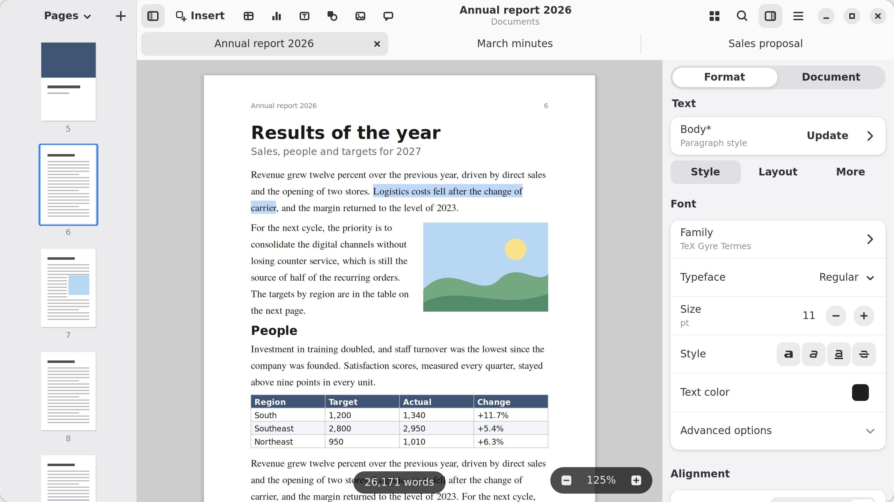
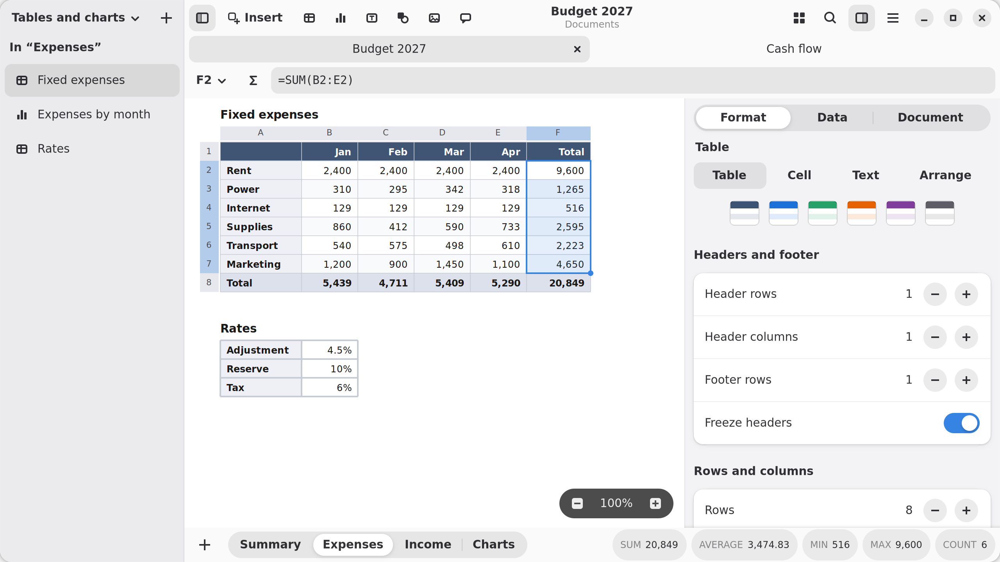
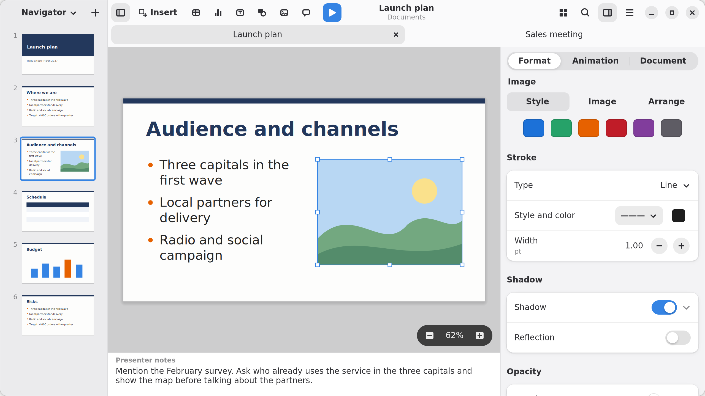

# The interface of Desk

*The window of Desk Writer, Desk Tables and Desk Slides: the layout chosen
on 2026-11-16 (M+, decision D-008), the inventory of its components, the
place of every command of iWork '09 in it, and the work that takes the
three apps there.*

The goal of Desk is feature parity with the current iWork, Pages, Numbers
and Keynote 15.4 (D-001), and not a copy of its interface. The window
follows the GNOME HIG and uses the widgets of Libadwaita 1.10 (GNOME 51)
wherever one exists (D-007). From iWork it keeps what makes someone who
comes from it feel at home: the names, the order of things, the Inspector,
and the model of iWork 15 with no format bar, where the Format pane follows
the selection.

| File | What it is |
| --- | --- |
| [`proposals/`](proposals/README.md) | The three windows drawn for the current iWork target (N, M and M+), with the comparison that led to M+. |
| [`components.tsv`](components.tsv) | The 101 components of window M+, one per row: the widget that draws it, what it does, what it was in iWork '09 and is in iWork today, its shortcut and its state in Desk today. It is the inventory of what to build. |
| [`iwork09-to-desk.tsv`](iwork09-to-desk.tsv) | The 933 commands, buttons, inspectors and windows of Pages 4.3, Numbers 2.3 and Keynote 5.3, read on the reference virtual machine, each with its place in window M+. |
| [`mockups/`](mockups) | The code that draws the mockups with the real GTK and Libadwaita, the catalogue the inventory comes from, and the Portuguese text of the mockups for the site. |
| [`iwork_map.py`](iwork_map.py) | The rules that take each item of iWork '09 to its place in Desk. |

The three parity matrices in [`corpus/`](../../corpus/README.md) say what
each app has to do. This directory says where each thing sits in the
window. The `gnome` column of the matrices points here in the rows that
the window changes.

## The decision

On 2026-11-16 the target of Desk became the current iWork (D-001), and two
windows were drawn for it: N, close to the toolbar of iWork 15, and M, the
same model put where the HIG puts each thing. M+ is M with the six object
buttons back in the header bar, so that nothing the toolbar of iWork shows
is hidden. M+ was chosen (D-008). [`proposals/`](proposals/README.md) has
the pictures of the three and the points where each follows or conflicts
with the HIG.

M+ replaces interface B, chosen on 2026-11-14 (R-004), which Desk Writer
follows today and on which the windows of Desk Tables and Desk Slides were
built in their phase 2. Interface B had a format bar under the header bar,
a bottom bar with the zoom and the word count, the sheets of Tables in the
sidebar, and one window per document. Its scenes stay in `mockups/`
(`writer-b` and the like) as the record of that decision, and its
description is in the history of this file.

## The minimum screen

Desk is made for desktop computers, laptops and tablets. The minimum screen
is **1280 × 720 pixels** (720p), in logical pixels, that is, after the
scale of the display: a 2560 × 1440 screen at 200 % counts as 1280 × 720,
and a 1920 × 1080 screen at 200 % counts as 960 × 540. On a tablet, the
screen in landscape counts. Phones and screens smaller than the minimum are
not supported: Desk opens on them and keeps working, but warns when it
opens that the experience may suffer (GNM-14, NGNM-14, KGNM-15). The window
opens at 1280 × 720.

The HIG asks every app to work on a 1024 × 600 screen. Desk asks for more,
because a page, a sidebar and the Inspector side by side need 1280 px. At
1024 × 600 the window still opens whole, with the notice, but design
decisions are neither made nor checked at that size.

The mockups of M+ are drawn at 1280 × 720. The minimum width and height of
each window were measured with GTK (`gtk_widget_measure`) for the three
versions of 2026-11-14, and they all fitted the minimum screen; the
measurement is made again on the windows of M+ as the three apps move to
it in phase B1. Two points of that measurement still hold:

- **Zoom on opening.** With the sidebar (196 px) and the Inspector
  (332 px) open, 752 px are left for the document at 1280 px. An A4 page
  at 100 % is 794 px wide, and a Letter page 816 px, so the page does not
  fit whole. Writer opens a document at the zoom that fits the page in the
  width, up to 100 %, like Fit Width in Pages.
- **Half a screen.** With two windows side by side on the minimum screen,
  each one is 640 px wide. The Inspector stays beside the page down to
  520 px and leaves about 300 px for it, which opens at the zoom that fits.

## The window



The window has the same regions in the three apps.

| Region | What it holds | Widget |
| --- | --- | --- |
| Navigation sidebar | A pane the height of the window, on the left, with its own header. The content switcher changes what it shows, and the + button adds a page or a slide. | `AdwOverlaySplitView`, `AdwToolbarView`, `AdwSidebar` |
| Header bar | Only what concerns the whole window. At the start, the Sidebar button, the Insert menu and the Table, Chart, Text, Shape, Media and Comment buttons. In the middle, the title, with the folder as subtitle. At the end, Open documents, Find, Inspector and the main menu. Slides also has the Play button. It is not customizable. | `AdwHeaderBar`, `GtkMenuButton` |
| Document tabs | One tab for each open document of the app, under the header bar, shown when two or more are open. | `AdwTabView`, `AdwTabBar` |
| Formula bar | Tables only, under the header bar: active cell, Function button and the content of the cell. Cancel and Accept appear while editing. | `GtkBox`, `GtkEntry` |
| Document | The page, the canvas of the sheet, or the slide with the presenter notes under it. The zoom control sits over a corner, and in Writer the word count over its foot. | `GtkScrolledWindow`, `GtkOverlay` and the widget of the document |
| Inspector | A utility pane on the right, only one, which shows what the selection has: 332 px, and 404 px when the tabs of an object or a table need it. | `AdwOverlaySplitView`, `AdwToggleGroup`, `AdwInlineViewSwitcher`, `AdwPreferencesGroup` |
| Bottom bar | Tables only: the + button and the sheet switcher at the start, the instant calculations at the end. | `GtkBox` with the `toolbar` class, `AdwToggleGroup` |

There is no format bar: what it held in iWork '09 and in interface B is in
the Format pane of the Inspector, as in iWork 15. Import warnings appear in
a banner (`AdwBanner`) over the document, and find is a bar under the
header bar. The small screen notice uses the same kind of banner.





### The navigation sidebar

| App | Pages that the content switcher shows | What the + button adds |
| --- | --- | --- |
| Writer | Pages (thumbnails), Styles, Comments, Search results | A page of the template |
| Tables | The tables and charts of the current sheet, Table styles, Comments, Search results, Formula list | A table or a chart; sheets are added from the bottom bar |
| Slides | Navigator, Outline, Master slides, Comments, Search results | A slide, from a master slide |

F9 shows and hides the sidebar. The Styles page is what Pages had in the
styles drawer, and Search results is the search sidebar of Pages. The
light table of Slides is not a page of the sidebar: it takes the document
area.

### The Inspector

The Inspector has two levels. The first is a switcher of short nouns. The
second is the tabs of what is selected, under a title that says what it is
(Text, Image, Shape, Table, Chart, Slide). When there is only one tab, the
tab switcher goes away.

| First level | Selection | Tabs |
| --- | --- | --- |
| Format | Text | Style, Layout, More |
| Format | Image | Style, Image, Arrange |
| Format | Shape or text box | Style, Text, Arrange |
| Format | Table | Table, Cell, Text, Arrange |
| Format | Chart | Chart, Axis, Series, Arrange |
| Format (Slides) | Nothing | Slide: layout, appearance and background |
| Data (Tables) | Table | Sort, Filter, Categories |
| Animation (Slides) | Object | Build In, Action, Build Out |
| Animation (Slides) | Nothing | Transition of the slide |
| Document (Writer) | Any | Document, Section, Info |
| Document (Tables) | Any | Sheet, Info |
| Document (Slides) | Any | Document, Audio, Info |

The ten inspectors of iWork '09 fit in these tabs: Text became Style,
Layout and More; Graphic became Style; Metrics and Wrap became Arrange;
Link became a popover; QuickTime shows when a sound or a movie is
selected. The properties use the ready-made rows of Libadwaita
(`AdwActionRow`, `AdwComboRow`, `AdwSpinRow`, `AdwSwitchRow`,
`AdwExpanderRow`) inside `AdwPreferencesGroup`.

Fonts and Colors are popovers opened from the font row and the color rows
of the Format pane, in place of the floating windows of iWork. Arrange
(order, align, distribute, flip, group, lock) is a tab of the Format pane
and the context menu of the object.

### The menus

The menu bar of iWork had 205 to 225 commands per app. In Desk they live in
four places, and Search Commands finds any of them by name, including the
name Apple gave it in Portuguese.

| Menu | Where | What it holds |
| --- | --- | --- |
| Main menu | End of the header bar (F10) | Twelve items at most: New document, Open, Open recent, Save as, Export, Print, View, Search commands, Preferences, Keyboard shortcuts, Help, About |
| View | Submenu of the main menu | Ruler, invisibles, layout, comments, word count and the light table, as the app needs; Fullscreen |
| Insert | Insert button | What the Insert menu of iWork had besides the objects: breaks, fields, footnote, table of contents, bookmark, link, special characters, Choose |
| Context menu | The document, the thumbnails, the navigator and the table | Edit, Arrange, the Table menu of Numbers and the Slide menu of Keynote |

The menus Window and the Hide commands belong to GNOME. Share goes away:
iWork.com was shut down, and exporting and sending by email are under
Export.

### Saving

Saving is automatic, with versions, as in iWork 15 (D-001, DOC-11): the
document saves itself, and the versions are browsed and restored from the
main menu. So the main menu has no Save item, and the subtitle of the
window shows the folder alone, with no Edited state. This replaces path L
of interface B, a recovery draft every two minutes (R-002).

### Narrower windows

The minimum screen is 1280 × 720, but a window can be narrower than the
screen, as when it sits beside another. Breakpoints take care of that, and
not of phones:

| Window width | What changes |
| --- | --- |
| Below 720 px | The navigation sidebar becomes an overlay, the object buttons go into the Insert menu, and Open documents leaves the header bar (the tabs remain) |
| Below 520 px | The Inspector becomes an overlay too: it closes and comes back over the document |

They are `AdwBreakpoint`s of the window. There is no phone layout and no
bottom sheet: below 520 px the window stays usable, without being
checked. The dark and high contrast styles come ready from Libadwaita.

### The small screen notice

When a window opens on a monitor smaller than 1280 × 720, a banner
(`AdwBanner`) under the bars at the top says:

> Screen smaller than 1280 × 720 ‒ parts of the window may not fit

The **Close** button hides the banner. Nothing is blocked and there is no
dialog: the HIG puts a lasting state like this one in a banner, and a toast
would go before it is read.

- **When.** On opening the first window of each app, after it appears,
  with the monitor it is on (`gdk_display_get_monitor_at_surface`). The
  measure is the geometry of the monitor, which GTK already gives in
  logical pixels; a width under 1280 or a height under 720 counts, so a
  tablet held upright also gets the notice.
- **Until when.** Once closed, the banner does not come back until the app
  starts again. There is no preference to silence it, and moving the window
  to another monitor does not show it again.
- **With other banners.** It sits above the banner of import warnings; the
  two can show together.
- **Tests.** The rule is a function of the geometry (width and height) and
  is tested alone; the interface test opens the window on a virtual
  1024 × 600 screen and checks the banner through the accessibility tree.

## Shortcuts

Desk is made for users of GNOME first (D-022). Three rules, in this order
(D-017):

1. Where GNOME has a standard shortcut, it applies.
2. Where GNOME says nothing, the shortcut of iWork 15.4 applies, with Ctrl
   for ⌘ and Alt for ⌥.
3. Where the two collide, the command of iWork gets a new shortcut, which
   shows in the shortcuts dialog (Ctrl+?) and in Search Commands.

The shortcuts of iWork '09 were read from the menus of the three apps on
the virtual machine, and compared one by one with those of iWork 15.4 on
the Mac on 2026-11-16. Where the two agree, the table gives one column.

| Command | iWork '09 and 15.4 | Desk | Rule | Note |
| --- | --- | --- | --- | --- |
| New, Open, Save as, Print, Close, Undo, Copy, Paste, Select all, Bold, Italic, Underline, Find | ⌘ and the letter | Ctrl and the same letter | 1 | They match |
| Deselect all | ⇧⌘A | Ctrl+Shift+A | 1 | It is what the HIG gives this command |
| Replace | In the panel of ⌘F | Ctrl+H | 1 | Find is a bar |
| Full screen | ⌃⌘F | F11 | 1 | |
| Zoom in, zoom out, actual size | ⌘> and ⌘< | Ctrl++, Ctrl+− and Ctrl+0 | 1 | Bigger and smaller font, which iWork has on ⌘+ and ⌘−, are in the size field |
| Sidebar | ⌥⌘P in '09 (thumbnails); no shortcut in 15.4 | F9 | 1 | For pages, sheets and slides |
| Main menu and keyboard shortcuts | Does not apply | F10 and Ctrl+? | 1 | |
| Paste and match style | ⌥⇧⌘V | Ctrl+Shift+V | 1 | |
| Insert, Choose | ⇧⌘V | Ctrl+Alt+P | 3 | Ctrl+Shift+V is paste and match style |
| Inspector | ⌥⌘I | Ctrl+Alt+I | 2 | |
| Ruler, layout, invisibles | ⌘R, ⇧⌘L, ⇧⌘I | Ctrl+R, Ctrl+Shift+L, Ctrl+Shift+I | 2 | |
| Fonts | ⌘T | None | 3 | Ctrl+T is a new tab in GNOME (D-024); Fonts opens from the Font row of the Format pane and from Search Commands |
| Colors | ⇧⌘C | Ctrl+Shift+C | 2 | It opens as a popover |
| New document in a tab | ⌘N | Ctrl+N or Ctrl+T | 1 | Ctrl+Shift+N opens a new window |
| Styles in the sidebar | ⇧⌘T in '09 (styles drawer); in 15.4, the comments pane | Ctrl+Shift+T | 2 | Kept as approved on 2026-11-15 |
| Paragraph styles | F1 to F8 in '09 | Ctrl+1 to Ctrl+8 | 3 | GNOME reserves F1, F9 and F10 |
| Duplicate, Lock, Group, Ungroup | ⌘D, ⌘L, ⌥⌘G, ⌥⇧⌘G | Ctrl+D, Ctrl+L, Ctrl+Alt+G, Ctrl+Shift+Alt+G | 2 | |
| Bring to front, send to back | ⇧⌘F, ⇧⌘B | Ctrl+Shift+] and Ctrl+Shift+[ | 3 | What Desk Writer already uses. One layer at a time: Ctrl+] and Ctrl+[ |
| Search results in the sidebar | ⌥⌘F in '09; gone in 15.4 | Ctrl+Alt+F | 2 | |
| Mask | ⇧⌘M | Ctrl+Shift+M | 2 | |
| Search commands | ⇧⌘? (search of the Help menu) | Ctrl+/ | 3 | In GTK text fields, Ctrl+/ selects all. In GTK 4.24.1 the shortcut of the app wins, and select all stays on Ctrl+A |
| Play the slideshow | ⌥⌘P | F5 | 3 | Ctrl+Alt+P is already Choose, and F5 is the custom for presentations on Linux |
| New slide | ⇧⌘N | Ctrl+M | 3 | Ctrl+Shift+N is already New window in Desk |
| Skip this slide | No shortcut in '09 | Ctrl+Shift+H | 2 | As in the current Keynote |
| Row above or below, column before or after | ⌥ and the arrows | Alt and the arrows | 2 | In Tables |
| Formula list | ⌥⌘F in '09; in 15.4, Turn Filters On | Ctrl+Shift+F | 3 | Ctrl+Alt+F already opens the search results. Ctrl+Shift+F keeps the F of Numbers and is free in Desk and in GNOME |

The shortcuts that were proposals were confirmed on 2026-11-14, and the
ten names and shortcuts of the table below again on 2026-11-15. The
format bar had Ctrl+Shift+R in interface B; M+ has no format bar, and the
shortcut goes away with it.

The document tabs follow D-023. `AdwTabView` brings the shortcuts of GNOME
for tabs, the same in the three apps:

| Command | Shortcut |
| --- | --- |
| Next and previous document | Ctrl+PageDown and Ctrl+PageUp, or Ctrl+Tab and Ctrl+Shift+Tab |
| Document 1 to 9 | Alt+1 to Alt+9 |
| Move the tab left or right | Ctrl+Shift+PageUp and Ctrl+Shift+PageDown |
| Next and previous sheet (Tables) | Alt+PageDown and Alt+PageUp |

The sheets had Ctrl+PageUp and Ctrl+PageDown, as in the spreadsheets of
LibreOffice and Microsoft Office; GNOME gives those keys to tabs, so the
sheets moved (rule 3). Ctrl+Home and Ctrl+End, which `AdwTabView` would
give to the first and last tab, stay with the text and the cells (the start
and the end of the document or of the table), so they are turned off in the
tab view of the three apps.

## HIG practices that the window follows

- **Header bar.** Only what concerns the whole window. Icon buttons have a
  tooltip and an accessible name, and the label shows where the icon alone
  is not enough, as in Insert.
- **Menus.** The main menu is at the end of the header bar and ends in
  Preferences, Keyboard shortcuts, Help and About. Submenus have one level.
- **Sidebar and utility pane.** Navigation is on the left. The Inspector is
  a utility pane on the right, which does not navigate, it only shows what
  the selection has.
- **View switchers.** Short labels, nouns, of similar length: Format, Data,
  Animation, Document.
- **One level of tabs per window.** The document tabs are the only tabs at
  the top; the sheets of Tables are a switcher in the bottom bar.
- **Boxed lists.** The properties use the rows of Libadwaita, and the
  switches have their label on the row.
- **Small popovers.** Fonts, Colors, shapes, media, stroke and opacity
  open attached to their button or row. What iWork opened in floating
  windows stays inside the window.
- **Notices of the right weight.** A banner for what affects the document,
  a toast for what needs no answer, and the alert dialog of GNOME where a
  choice is needed.
- **A window that adapts.** A minimum screen of 1280 × 720 with a notice
  below it; breakpoints for half a screen and smaller windows (720 and
  520 px); dark style and high contrast.
- **Keyboard.** The standard GNOME shortcuts come first, and every command
  shows in the shortcuts dialog and in Search Commands.
- **Interface text.** Sentence case and the terms of the GNOME glossary:
  Find, View, Format, Lock, Outline, Sheet. The names of iWork stay when
  they do not conflict: Inspector, Navigator, Light Table, Instant Alpha.
  The Brazilian Portuguese translation follows the same rules.

## From iWork '09 to Desk

[`iwork09-to-desk.tsv`](iwork09-to-desk.tsv) has one row for each menu
command, toolbar item, format bar mode, Inspector tab, preference pane and
window of the three apps, with its name in English, the name Apple gave it
in Portuguese, the shortcut, its place in window M+ and the component that
holds it.

| | Pages 4.3 | Numbers 2.3 | Keynote 5.3 |
| --- | --- | --- | --- |
| Menu commands | 225 | 205 | 208 |
| Items the toolbar accepts | 48 | 39 | 50 |
| Format bar modes | 18 | 19 | 17 |
| Inspector tabs | 19 | 12 | 19 |
| Preference panes | 3 | 3 | 6 |
| Windows, sheets and panels | 19 | 9 | 14 |
| **Total** | **332** | **287** | **314** |

The `how` column says what happened to each:

| | Pages | Numbers | Keynote | Total |
| --- | --- | --- | --- | --- |
| `same`: same place and same form | 49 | 37 | 38 | 124 |
| `adapted`: another place or form, the GNOME way | 258 | 226 | 241 | 725 |
| `system`: GNOME takes care of it (windows, hiding the app) | 6 | 6 | 6 | 18 |
| `out`: out of scope | 19 | 18 | 29 | 66 |

What stays out: iWork.com, the sending to iDVD, iPhoto, iTunes,
GarageBand, YouTube and the iPod, Keynote Remote, the Automator actions,
the tutorials and the registration of Apple, the customization of the
toolbar, the New Inspector command, and the commands that show and hide the
format bar, which M+ does not have. The format bar modes themselves are
`adapted`: each became tabs of the Format pane.

These rows read iWork '09, whose inventory was taken on the virtual
machine. The features of iWork 15.4 are in the inventory of the current
target (`corpus/inventory/`) and in the matrices; the place of each one in
the window follows the same rules.

The inventory on the virtual machine also found commands that the manuals
do not mention and the matrices lacked. They went into the matrices with
the prefixes `VMI`, `NVMI` and `KVMI`: Deselect all, Reapply defaults to
the selection, the connection lines of linked text boxes, Reset text and
object handles, the column break in the text of Tables and Slides, the
older animations, the geometry of the chart in master slides, and Fit to
window.

## The components

[`components.tsv`](components.tsv) has 138 rows. Each one is a piece that
appears in the mockups of M+, with the type of the widget read from the
mockup itself, and its state measured against the Desk of today: `exists`
is already there in this form, even if it does nothing yet; `changes` is
there in another form or place; `new` is still to be written.

| Section | Exists | Changes | New |
| --- | --- | --- | --- |
| Window and header bar | 10 | 5 | 1 |
| Sidebar | 5 | 1 | |
| Formula bar (Tables) | 5 | | |
| Document | 4 | | |
| Inspector | 42 | 2 | 1 |
| Inspector of Tables | 3 | | 9 |
| Inspector of Slides | | | 7 |
| Bottom bar and controls over the view | | 3 | 3 |
| Find, notices and commands | 9 | 1 | 4 |
| Popovers | 6 | 1 | 3 |
| Template chooser and dialogs | 6 | 6 | 1 |
| **Total** | **90** | **19** | **29** |

Writer uses 105 of them, Tables 75 and Slides 64 (the dialogs and the
template chooser count for the three); everything common to the
three is in `desk-ui`. What changes from interface B is the frame of the
window: the header bar loses the View menu of the Sidebar button and gains
Open documents, the documents open in tabs, the main menu loses Save and
gains View, the bottom bar of Writer and Slides gives way to the controls
overlaid on the document, the bottom bar of Tables takes the sheets, and
order and grouping move from the format bar to the Arrange tab. The new
pieces are the document tabs, the sheet switcher, and the tabs of the
Inspector that the phases of tables, charts and builds fill.

The mockups of M+ draw the main windows, the Format, Data, Animation and
Document levels of the Inspector, and what opens from the window: the
Insert menu, the Shape popover, the main menu, Fonts and Colors opened
from their rows in the Format pane, the find bar with the banner of import
warnings, Search Commands, Preferences, Keyboard Shortcuts, the template
chooser, the window at half the minimum screen, and the small screen
notice. Their pictures are in [`scenes`](scenes). There is no close dialog
in M+: saving is automatic (D-001), so closing a document asks nothing,
and `dialog.close` stays in `catalog.txt` as a piece of interface B only.

| Scene | Picture |
| --- | --- |
| Image selected, Document level, dark style | [image](scenes/writer-m-plus-image.png), [Document](scenes/writer-m-plus-document.png), [dark](scenes/writer-m-plus-dark.png) |
| Data level of Tables, Animation level of Slides | [Data](scenes/tables-m-plus-data.png), [Animation](scenes/slides-m-plus-animate.png) |
| Insert menu, Shape popover, main menu | [Insert](scenes/writer-m-plus-insert.png), [Shape](scenes/writer-m-plus-shapes.png), [menu](scenes/writer-m-plus-menu.png) |
| Fonts and Colors from the Format pane | [Fonts](scenes/writer-m-plus-fonts.png), [Colors](scenes/writer-m-plus-colors.png) |
| Find bar and the banner of import warnings | [find](scenes/writer-m-plus-find.png) |
| Search Commands, Preferences, Keyboard Shortcuts | [commands](scenes/common-m-plus-commands.png), [Preferences](scenes/common-m-plus-preferences.png), [shortcuts](scenes/common-m-plus-shortcuts.png) |
| Template chooser | [templates](scenes/common-m-plus-templates.png) |
| Half of the minimum screen (640 × 720) | [half](scenes/common-m-plus-half.png) |
| Screen smaller than the minimum (1024 × 600) | [notice](scenes/common-m-plus-notice.png) |

In the window at half the screen the sidebar is closed and the object
buttons and Open documents leave the header bar: the objects go back into
Insert, and the tabs still switch documents. The word count sits above the
zoom control, since the two no longer fit side by side.

## The order of the work

Phase B1 of the [roadmap](../roadmap.md) moves the three apps from
interface B to M+, in steps that each leave the apps working, one pull
request each:

| Step | What it does | Matrix rows |
| --- | --- | --- |
| 1. Header bar and document tabs (done) | Sidebar button without the View menu, Open documents, the main menu with View and without Save, documents in tabs of one window | INT-11, GNM-01, GNM-10 |
| 2. Format pane in place of the format bar (done) | What the format bar held moves to the Format pane, with Fonts and Colors as popovers from its rows, and Arrange becomes a tab | INT-12, INT-13 |
| 3. Controls over the document (done) | The zoom control and the word count overlaid, in place of the bottom bar of Writer and Slides | GNM-13, KGNM-14, INT-07, INT-19, DOC-20 |
| 4. Bottom bar of Tables (done) | The sheet switcher and the + button with the instant calculations; the sidebar shows the tables and charts of the sheet | NGNM-12, NGNM-13 |
| 5. Automatic saving and versions | In place of the recovery draft of path L | DOC-11 |

Each step changes the tests with the code. The rows that a step reshapes
stay open until it is done, and the parity report keeps counting them as
tested while the tests check the older form.

## History

Before M+, three versions of the window were drawn for the target of iWork
'09: A, close to iWork '09 with many buttons in the header bar and the
icon Inspector; B, the balanced one; and C, close to the apps of GNOME,
with no format bar. B was chosen on 2026-11-14 (R-004) and built in seven
steps in Desk Writer (the frame of the window, the header bar and menus, the
slim format bar, the two-level Inspector, the pages of the sidebar, the
bottom bar, and the commands and shortcuts), then in the windows of phase 2
of Tables and Slides. [docs/project-log.md](../project-log.md) tells that
work and its decisions. Much of it carries over to M+: the sidebar and its
pages, the two-level Inspector and its tabs, the Insert menu and the
object buttons, the shortcuts, and the small screen notice.

## Drawing the mockups again

The mockups are real windows, built in Python with GTK 4.24 and Libadwaita
1.10 and shot off screen. `ci/setup-env.sh` installs the environment, and
the repository has to be under the home folder or under `/tmp`.

```sh
docs/interface/mockups/run.sh                 # every scene and the inventory of M+
docs/interface/mockups/run.sh out writer-m-plus
DESK_MOCKUP_LANG=pt docs/interface/mockups/run.sh out-pt writer-m-plus  # for the Portuguese site
```

The scenes are written in English. `DESK_MOCKUP_LANG=pt` draws them in
Brazilian Portuguese with [`mockups/pt_BR.tsv`](mockups/pt_BR.tsv), for the
Portuguese page of the site, which is a translation and so stays under the
exception of D-018.

Each piece drawn has an id, and `inventory.py` refuses a scene that has a
piece with no row in `catalog.txt`. So a mockup cannot gain a control that
nobody documented. After a rule in `iwork_map.py` changes, the map is made
again from the inventory of iWork '09, which stays outside the repository
because it was read from Apple software (D-011):

```sh
python3 docs/interface/iwork_map.py <inventory folder> \
    docs/interface/iwork09-to-desk.tsv docs/interface/mockups/catalog.txt
```
