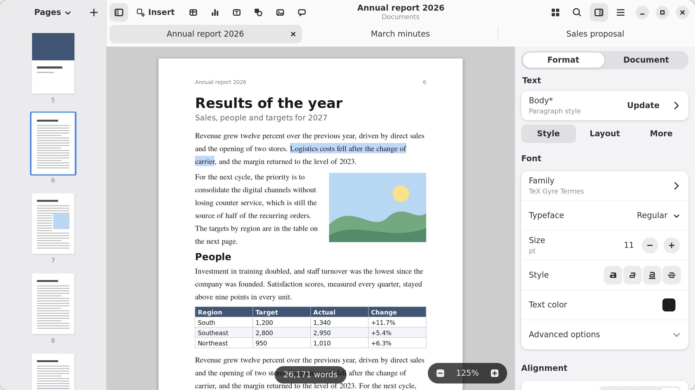
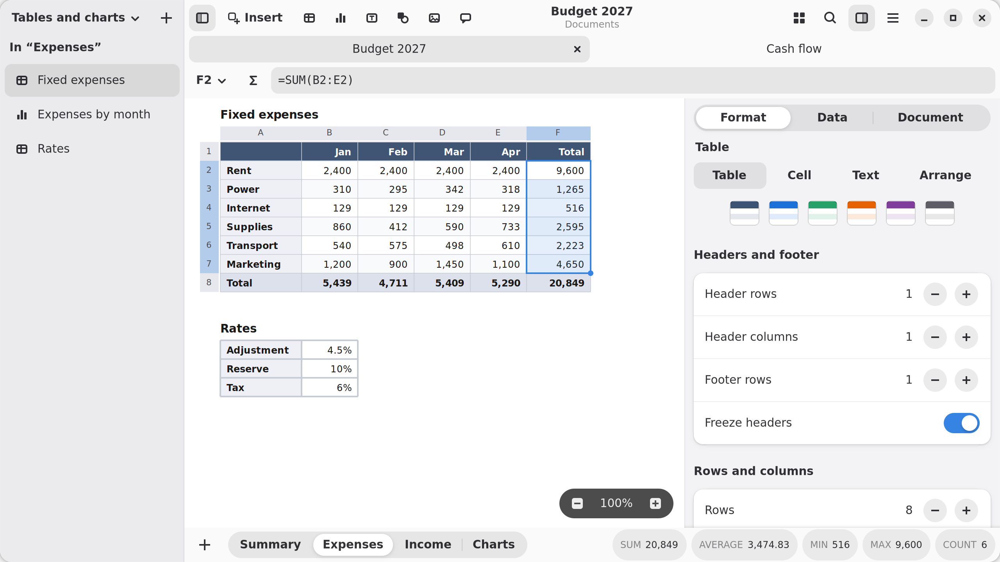
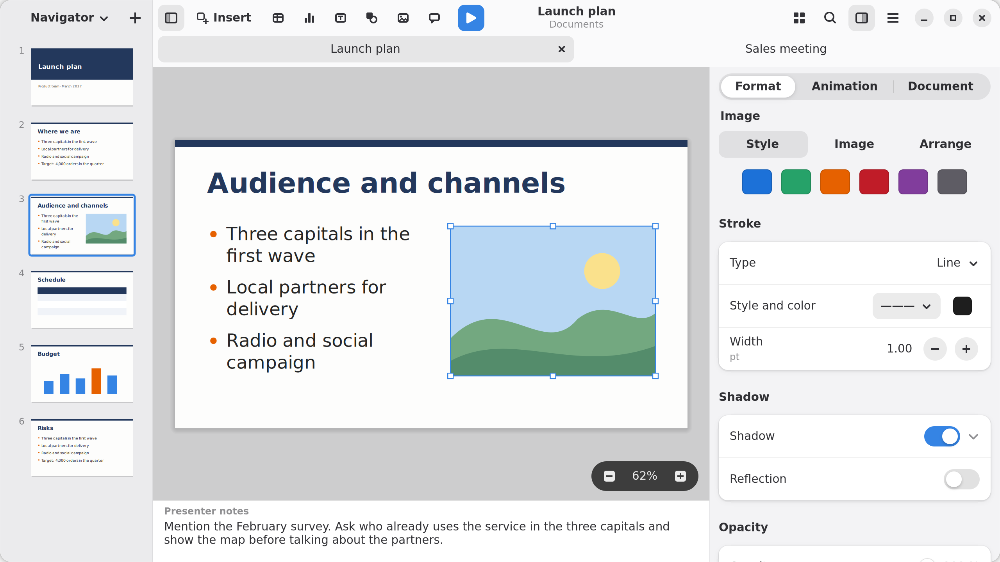
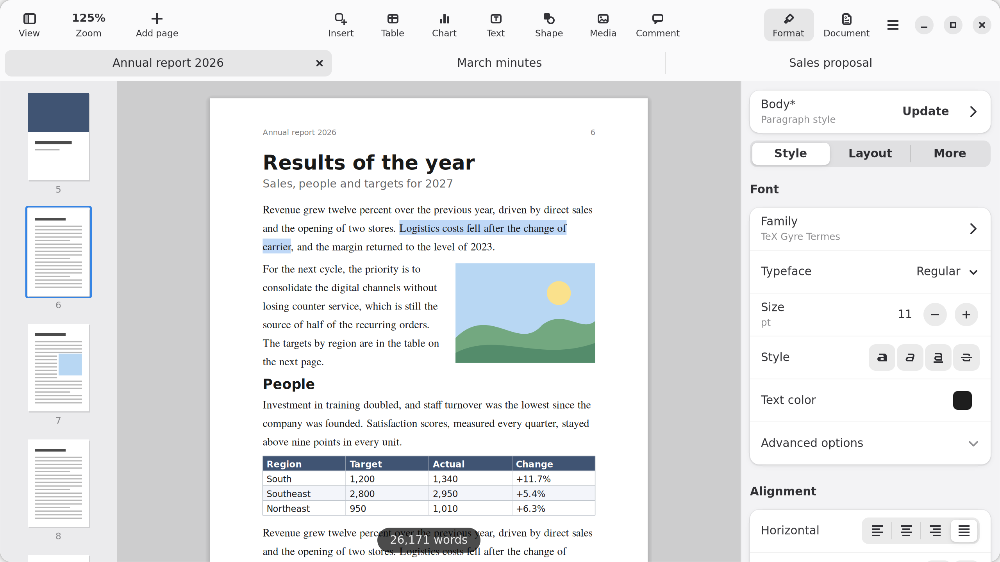
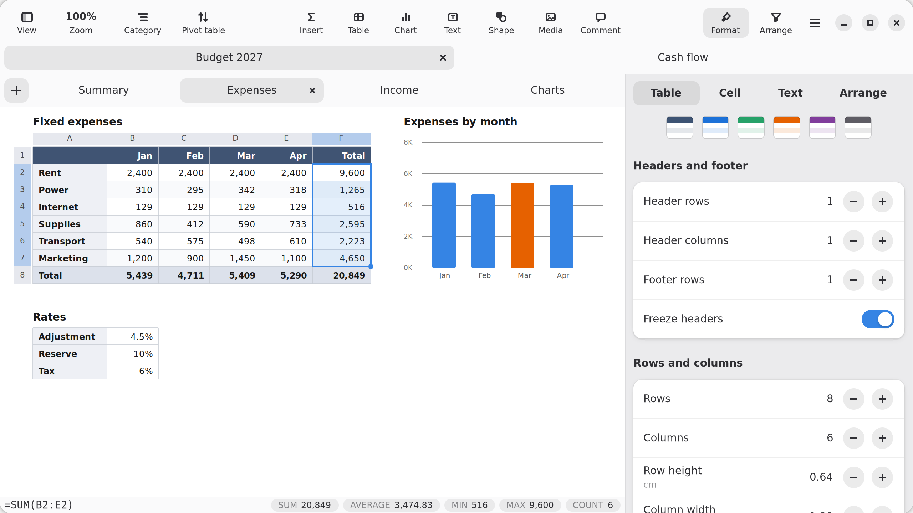
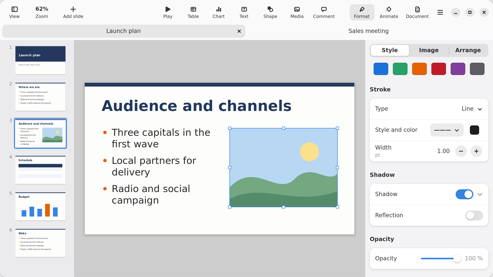
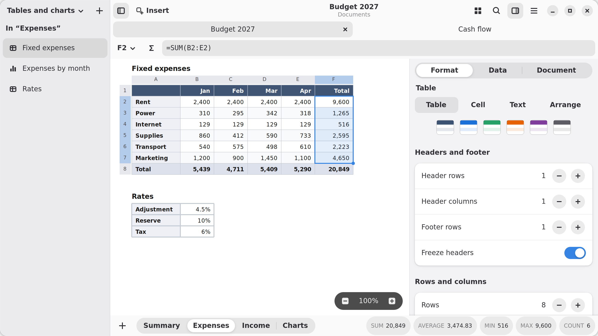
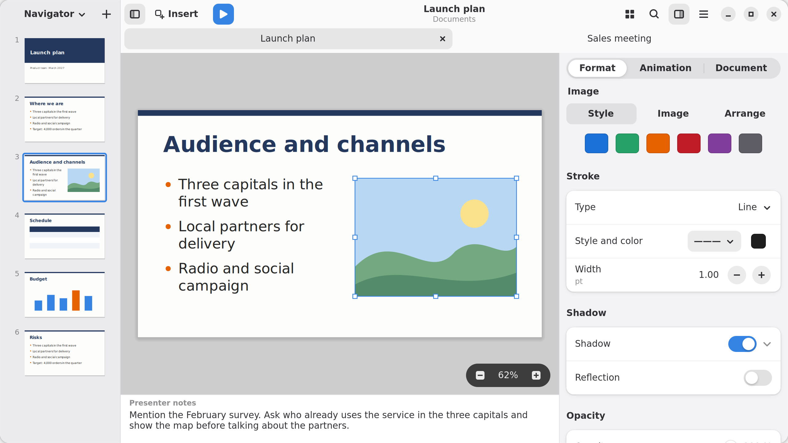

# The window for the current iWork target (2026-11-16)

The target of Desk is feature parity with the current iWork (Pages, Numbers
and Keynote 15.4). Two windows were proposed for it, N and M, and a variant
of the second, M+. **M+ was chosen on 2026-11-16 (decision D-008).** N and M
stay here as the record of what was compared.

The pictures are drawn with the real GTK 4.24 and Libadwaita 1.10, at
1280 × 720, by the generator in [`../mockups`](../mockups)
(`proposals.py`). None of them is implemented yet: the three apps keep
interface B until phase B1 of the [roadmap](../../roadmap.md), and
[docs/interface/README.md](../README.md) describes M+ and the
steps that take the apps there.

| | N: current iWork | M: mix with the HIG |
| --- | --- | --- |
| Idea | The window of Pages, Numbers and Keynote 15.4, with Libadwaita widgets where they exist | The same model as the 15 (contextual Format pane, tabs, no format bar), put where the HIG puts each thing |
| Top bar | Toolbar with 12 or 13 items of icon and caption: View, Zoom, Add, the objects, and Format, Animate and Document | Header bar with icon buttons, the window title and the main menu; one Insert button |
| Navigation | Pane under the toolbar | Sidebar of the height of the window, with the content switcher |
| Right pane | The Format, Animate, Arrange and Document buttons of the toolbar choose what it shows | One Inspector button; Format, Animation, Data and Document are chosen inside the pane |
| Several documents | Tabs (`AdwTabBar`) | Tabs (`AdwTabBar`) and the Open Documents button |
| Sheets of Tables | Tabs under the toolbar, with Add at the start, as in Numbers | Switcher in the bottom bar, beside the instant calculations |
| Formula of Tables | In the bottom bar, like the smart cell view of Numbers | Formula bar under the header |
| Zoom | Toolbar item | Control overlaid on the document |
| Word count | Overlaid on the document | Overlaid on the document |
| Find | In the View menu and with Ctrl+F | Button in the header bar |

## M+: M with the objects in the header (chosen)

M+ was drawn so that no function that N shows stays hidden in M: Table,
Chart, Text, Shape, Media and Comment return to the header as icon buttons
with a tooltip, beside Insert, which keeps the rest (breaks, fields, notes).
The HIG accepts it: they are the most used actions of the window.





Where each thing that N shows in its toolbar is found:

| In N, explicit in the toolbar | In M and in M+ |
| --- | --- |
| Table, Chart, Text, Shape, Media, Comment | M: inside the Insert button. M+: icon buttons in the header |
| View | The sidebar button and the content switcher at the top of the sidebar |
| Zoom | Control overlaid on the document |
| Add page or slide | The + button at the top of the sidebar |
| Format, Document, Animate, Arrange | The Inspector button, and the choice at the top of the pane |
| Category and Pivot table | The Data tab of the Inspector, and Insert |
| Play | Button in the header |
| Sheets as tabs at the top | Switcher in the bottom bar |

## N: current iWork





## M: mix with the HIG





## Desk's own components

Components that Libadwaita 1.10 does not have and that Desk builds following
the HIG. They are the ones to review at each new release of Libadwaita. In
the generator, their id starts with `proprio.`.

| Component | N | M and M+ | What to review |
| --- | --- | --- | --- |
| Toolbar item with an icon and a caption under it | Yes, 12 or 13 per window | No | Whether Libadwaita gains a button with a caption under it, or a toolbar of its own |
| Page, sheet grid and slide (the document area) | Yes | Yes | They belong to Desk in any case |
| Page and slide thumbnails | Yes | Yes | The same |
| Table style and object style swatches in the Inspector | Yes | Yes | Whether a swatch gallery appears |
| Instant calculation chips | Yes | Yes | Whether a chip widget appears |
| Colors popover: the palette of the HIG, the colors of the document, the eyedropper, Custom… and None (`crate::color_popover`) | No | Yes | Whether Libadwaita gains a color popover or palette; GTK's own `GtkColorChooser` is deprecated |
| Shape library popover: categories in a `navigation-sidebar` list, a search entry and a grid of shape pictures, with a context menu on My Shapes (`crate::shape_popover`, W113) | No | Yes | Whether Libadwaita gains a searchable grid picker, such as an emoji or symbol chooser to reuse |
| Saved Fills popover: a grid of fill swatches with Save Fill and a right-click Delete (`crate::fill_rows`, W121) | No | Yes | Whether Libadwaita gains a swatch grid or color palette widget |

The rest is native: `AdwHeaderBar`, `AdwTabView` and `AdwTabBar`,
`AdwOverlaySplitView`, `AdwToolbarView`, `AdwSidebar`, `AdwToggleGroup`,
`AdwInlineViewSwitcher`, `AdwPreferencesGroup` and the `Adw*Row` rows,
`GtkPopover`, and the overlaid controls with the `osd` and `toolbar` classes.

## Conflicts with the HIG

| Point of the HIG | N | M and M+ |
| --- | --- | --- |
| Header bar with few controls, as icons | Conflicts: 12 or 13 items with a caption | Follows; M+ adds six icon buttons |
| Window title in the header bar | Conflicts: the title appears only on the tab | Follows |
| Main menu at the end of the header bar | Follows (iWork has none; it was added) | Follows |
| Sidebar of the height of the window | Conflicts in part: the pane is under the toolbar | Follows |
| One level of tabs per window | Conflicts in Tables: document tabs and sheet tabs, one above the other | Follows: the sheets are in a switcher at the bottom |
| Find from a button in the header bar | Conflicts: only from the menu and the shortcut | Follows |
| Narrow windows (breakpoints) | The toolbar needs about 1150 px; below that the items go to a menu | Like interface B: collapses the sidebar and then the Inspector |

## What all of them change from interface B

- The format bar goes away: what it held moves to the Format pane.
- The bottom bar of Writer and Slides goes away; the word count is overlaid.
- Documents open in tabs, no longer one window each.
- The sheets of Tables leave the sidebar.
- The "Edited" subtitle goes away: saving is automatic.

## Drawing them again

```sh
cd docs/interface/mockups
./run.sh out writer-m tables-m slides-m writer-n tables-n slides-n
```

The scenes are written in English. `DESK_MOCKUP_LANG=pt` draws them in
Brazilian Portuguese with `pt_BR.tsv`, for the Portuguese page of the site;
a string the table does not know shows in English in the picture.
