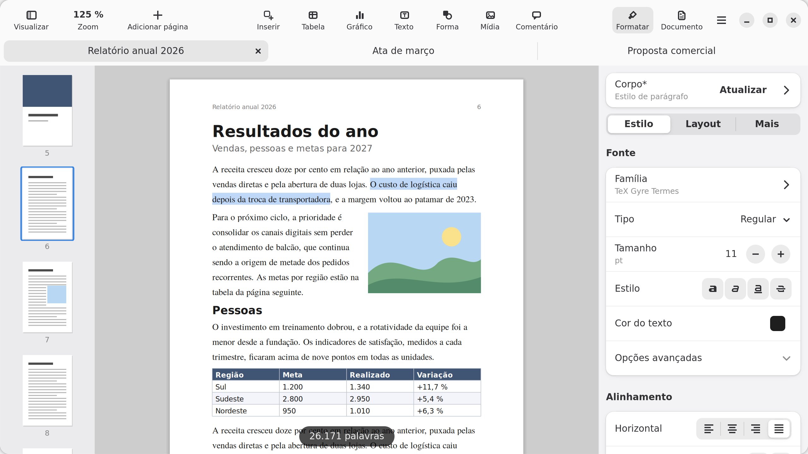
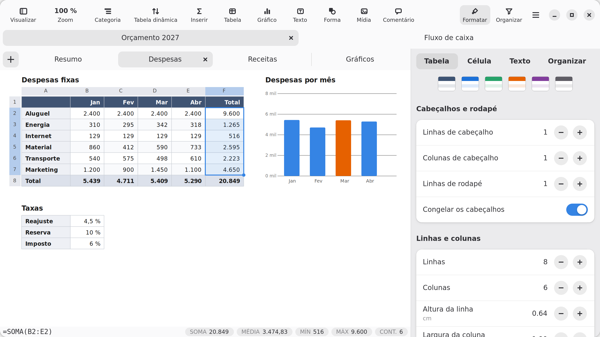
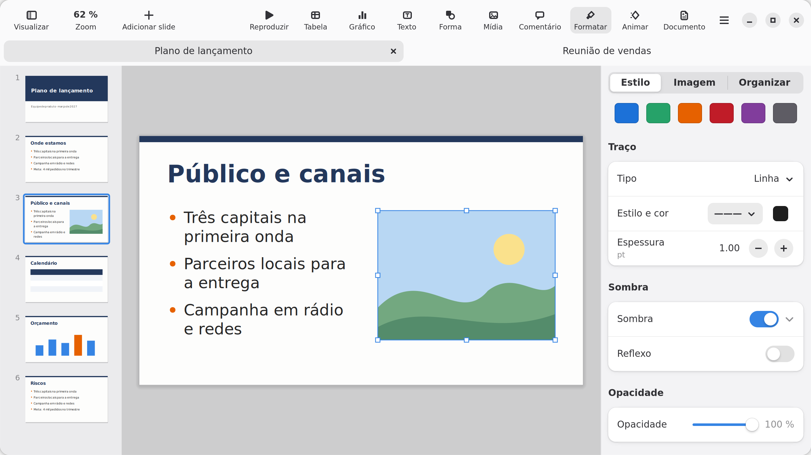
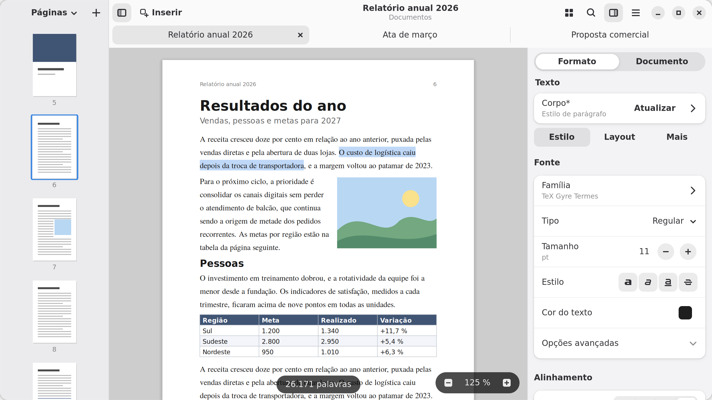
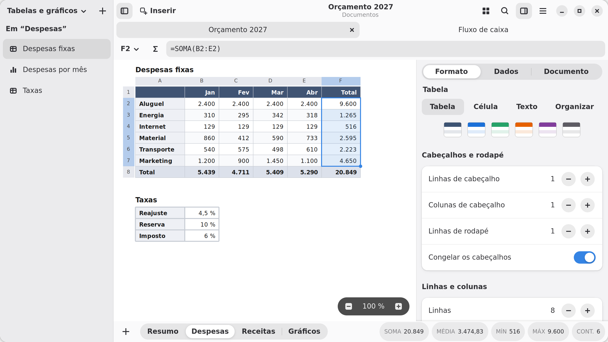
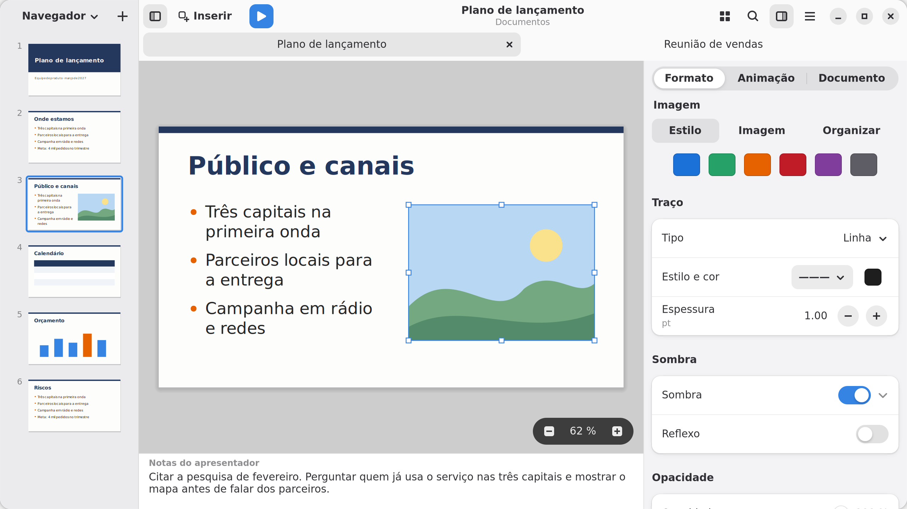
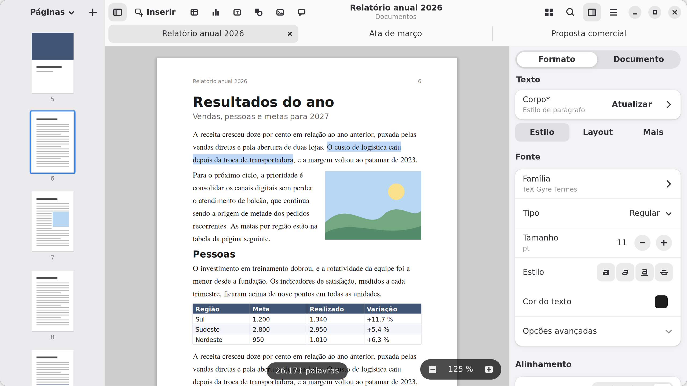
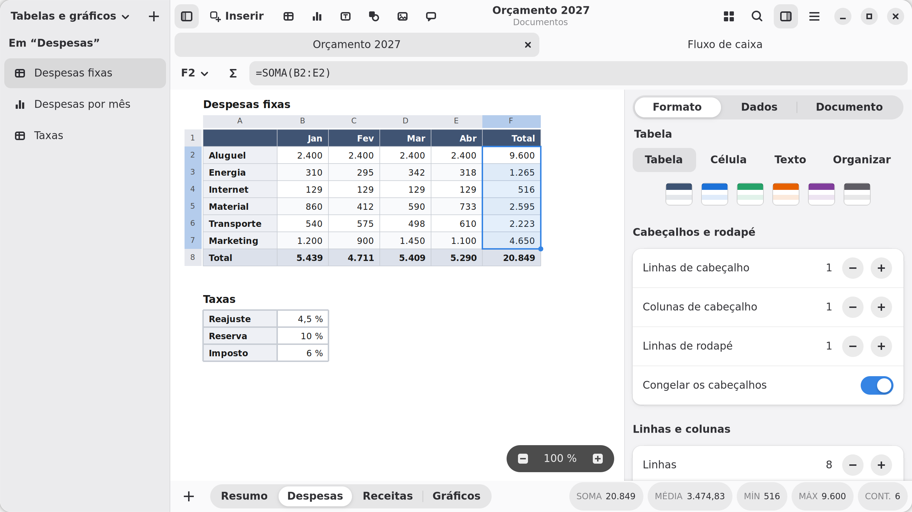
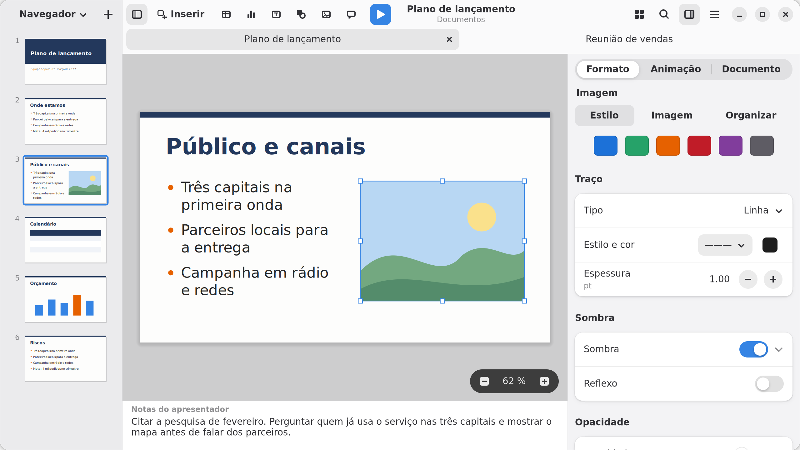

# Duas propostas de janela para o alvo novo (16/11/2026)

*Two window proposals for the new target of Desk, the current iWork
(Pages, Numbers and Keynote 15.4), in Portuguese like the rest of
`docs/interface`. One of them replaces interface B when it is chosen.*

O alvo do Desk passou a ser a paridade com o iWork atual. Estas são as duas
janelas pedidas para a escolha, desenhadas com o GTK 4.24 e a Libadwaita
1.10 de verdade, em 1280 × 720, pelo gerador de
[`../mockups`](../mockups) (`novo.py`). Nenhuma está implementada: os três
aplicativos continuam com a interface B até a escolha.

| | N: iWork atual | M: mix com a HIG |
| --- | --- | --- |
| Ideia | A janela do Pages, Numbers e Keynote 15.4, com widgets da Libadwaita onde existem | O mesmo modelo do 15 (painel Formato contextual, abas, sem barra de formatação), posto onde a HIG põe cada coisa |
| Barra do alto | Barra de ferramentas com 12 ou 13 itens de ícone e legenda: Visualizar, Zoom, Adicionar, os objetos, e Formatar, Animar e Documento | Barra de cabeçalho com botões de ícone, o título da janela e o menu principal; um botão Inserir |
| Navegação | Painel sob a barra de ferramentas | Barra lateral da altura da janela, com o seletor de conteúdo |
| Painel da direita | Os botões Formatar, Animar, Organizar e Documento da barra escolhem o que ele mostra | Um botão Inspetor; Formato, Animação, Dados e Documento são escolhidos dentro do painel |
| Vários documentos | Abas (`AdwTabBar`) | Abas (`AdwTabBar`) e o botão Documentos abertos |
| Planilhas do Tables | Abas sob a barra, com Adicionar no início, como no Numbers | Seletor na barra inferior, ao lado dos cálculos instantâneos |
| Fórmula do Tables | Na barra inferior, como a célula inteligente do Numbers | Barra de fórmulas sob o cabeçalho |
| Zoom | Item da barra de ferramentas | Controle sobreposto ao documento |
| Contagem de palavras | Sobreposta ao documento | Sobreposta ao documento |
| Buscar | No menu Visualizar e por Ctrl+F | Botão na barra de cabeçalho |

## N: iWork atual

## M: mix com a HIG

## Componentes próprios

Componentes que a Libadwaita 1.10 não tem e que o Desk constrói seguindo a
HIG. São os que precisam de revisão a cada versão nova da Libadwaita. No
gerador, levam um id que começa com `proprio.`.

| Componente | N | M | O que rever |
| --- | --- | --- | --- |
| Item de barra de ferramentas com ícone e legenda embaixo | Sim, 12 ou 13 por janela | Não | Se a Libadwaita ganhar um botão com legenda embaixo, ou uma barra de ferramentas própria |
| Página, grade da planilha e slide (a área do documento) | Sim | Sim | São do Desk de qualquer forma |
| Miniaturas de páginas e de slides | Sim | Sim | Idem |
| Amostras de estilo de tabela e de objeto no Inspetor | Sim | Sim | Se surgir uma galeria de amostras |
| Fichas do cálculo instantâneo | Sim | Sim | Se surgir um widget de ficha (chip) |

O resto é nativo: `AdwHeaderBar`, `AdwTabView` e `AdwTabBar`,
`AdwOverlaySplitView`, `AdwToolbarView`, `AdwSidebar`, `AdwToggleGroup`,
`AdwInlineViewSwitcher`, `AdwPreferencesGroup` e as linhas `Adw*Row`,
`GtkPopover`, e os controles sobrepostos com as classes `osd` e `toolbar`.

## Conflitos com a HIG

| Ponto da HIG | N | M |
| --- | --- | --- |
| Barra de cabeçalho com poucos controles, de ícone | Conflita: 12 ou 13 itens com legenda | Segue |
| Título da janela na barra de cabeçalho | Conflita: o título só aparece na aba | Segue |
| Menu principal no fim da barra de cabeçalho | Segue (o iWork não tem; foi acrescentado) | Segue |
| Barra lateral da altura da janela | Conflita em parte: o painel fica sob a barra | Segue |
| Um nível de abas por janela | Conflita no Tables: abas de documentos e abas de planilhas, uma sobre a outra | Segue: as planilhas ficam num seletor embaixo |
| Busca por um botão na barra de cabeçalho | Conflita: só pelo menu e pelo atalho | Segue |
| Janelas estreitas (pontos de quebra) | A barra de ferramentas precisa de uns 1150 px; abaixo disso os itens vão para um menu | Como a interface B: recolhe a barra lateral e depois o Inspetor |

## O que as duas mudam em relação à interface B

- Some a barra de formatação: o que ela tinha passa para o painel Formato.
- Some a barra inferior do Writer e do Slides; fica a contagem sobreposta.
- Os documentos abrem em abas, e não mais numa janela cada um.
- As planilhas do Tables deixam a barra lateral.
- O subtítulo "Editado" some: o salvamento é automático.

## M+: o M com os objetos no cabeçalho

Variante desenhada em 16/11 para que nenhuma função do N fique escondida no
M: Tabela, Gráfico, Texto, Forma, Mídia e Comentário voltam ao cabeçalho
como botões de ícone com dica, ao lado de Inserir, que guarda o resto
(quebras, campos, notas). A HIG aceita: são as ações mais usadas da janela.

| No N, explícito na barra | No M e no M+ |
| --- | --- |
| Tabela, Gráfico, Texto, Forma, Mídia, Comentário | M: dentro do botão Inserir. M+: botões de ícone no cabeçalho |
| Visualizar | Botão da barra lateral e o seletor de conteúdo no alto dela |
| Zoom | Controle sobreposto ao documento |
| Adicionar página ou slide | Botão + no alto da barra lateral |
| Formatar, Documento, Animar, Organizar | Botão Inspetor, e a escolha no alto do painel |
| Categoria e Tabela dinâmica | Aba Dados do Inspetor e Inserir |
| Reproduzir | Botão no cabeçalho |
| Planilhas em abas no alto | Seletor na barra inferior |
