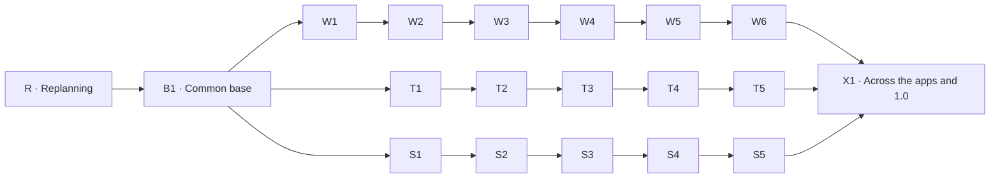

# Roadmap

The implementation plan for the target of [goals.md](goals.md), written on
2026-11-16. It replaces the plan of phases 1 to 11 per app that aimed at
iWork '09. The `phase` column of [`corpus/inventory`](../corpus/inventory/README.md)
gives every feature its phase; that first assignment is by area and is
refined row by row when a phase starts.

## How a phase runs

1. **Start:** list the rows of the inventory in the phase, and for each one
   the rows of the parity matrix that test it; write the missing matrix
   rows; specify the ODF extensions the phase needs in
   [odf-extensions.md](odf-extensions.md).
2. **Work:** each feature comes with tests, comments by the standard of
   [CONTRIBUTING.md](../CONTRIBUTING.md), and its row of the inventory
   updated. Behaviour is checked against iWork 15.4 on the Mac (D-012).
3. **Anything left undone** gets a row in
   [`backlog/deferred.tsv`](backlog/README.md) in the same pull request,
   and the owner is told.
4. **End:** the backlog of the phase is worked, then
   `ci/check-backlog.py --phase NAME` and `ci/check-all.sh` pass. A row
   that still cannot be done moves to a named phase, with the owner told.

## Where Desk is

Read on 2026-11-16 at commit `a0e5ca5`, by the new target: of 494 features
in scope, 62 are done and need no second look. Writer has its text engine,
structure, writing tools, objects, tables and charts; Tables and Slides
have a window and engines that the apps do not use yet.

## Phases

The three app tracks can run side by side after B1. The estimate counts
them one after the other.

| Phase | What it delivers | Inventory rows | Estimate (days) |
| --- | --- | --- | --- |
| **R** Replanning | Goals, decisions, backlog register, inventory, window proposals, ODF catalogue, architecture, this roadmap, contributor guides | - | In progress |
| **B1** Common base | The M+ window in the three apps (the format bar and the bottom bar give way to the Format pane and overlays; documents in tabs; sheet switcher); automatic saving and versions in place of the recovery draft; the reference cases redone on iWork 15.4; the 20 rows left from the old Writer phase 7 (B-001); full definitions of the 43 existing extensions (B-008); the secondary scenes of the mockups (B-003); matrices and `docs/interface` rewritten for the new target (B-006) and translated to English (B-009); README, site and metainfo (B-007) | 51 | 7 |
| **W1** Writer: to the behaviour of 15 | Text, styles, paragraphs, view and table features that exist as in '09 and now follow 15.4, keeping what the '09 did (D-003) | 28 | 4 |
| **W2** Writer: review | Comment threads with replies, tracking of changes including format and table cells, markup views, the review pane | 8 | 3 |
| **W3** Writer: structure and templates | Page templates, placeholders, live table of contents, bookmarks, mail merge with preview, text and page layout documents | 9 | 3 |
| **W4** Writer: objects and charts of 15 | Shape library, combining and drawing shapes, image gallery, captions, 3D objects, equations, audio recording, new chart types, interactive charts | 21 | 4 |
| **W5** Writer: files | Open `.docx`, current `.pages` (D-011) and LibreOffice ODT in full; export `.docx`, PDF and EPUB from the window; print; password | 21 | 6 |
| **W6** Writer: finish | Help, right-to-left and vertical text, accessibility pass, translations | 1 | 2 |
| **T1** Tables: sheets and files of its own | ODS read and written; cells connected to the table, formula and chart engines; several tables on a sheet | 33 | 4 |
| **T2** Tables: cells and formulas | Formats and cell controls, the function browser, the functions of 15.4 that need no network, arrays that spill, the formula list of '09 | 32 | 4 |
| **T3** Tables: organize | Sort, quick and full filters, categories, pivot tables, search inside formulas | 12 | 3 |
| **T4** Tables: charts, text and objects | Chart types and styles of 15, and the text and object features shared with Writer | 52 | 4 |
| **T5** Tables: files and print | Open `.xlsx`, `.numbers` of '09 and current; export `.xlsx` and PDF; print view; templates | 26 | 5 |
| **S1** Slides: presentations and themes | ODP read and written; themes, masters and layouts; the check of what Slides inherits from Writer (B-002); views | 35 | 4 |
| **S2** Slides: text, objects, media | The text, object, sound and video features, shared with Writer and new in 15 | 58 | 3 |
| **S3** Slides: animation | The transition and build engine, Magic Move, the effects of '09 kept by D-003 | 9 | 5 |
| **S4** Slides: presenting | Play full screen and in a window, presenter display, rehearsal, recording, links and kiosk options | 11 | 3 |
| **S5** Slides: tables, charts, files, print | Tables and charts on slides; open `.pptx`, `.key` of '09 and current; export `.pptx` and PDF; handouts | 25 | 5 |
| **X1** Across the apps and 1.0 | Live links of charts and tables between documents (D-002), copy and paste among the apps, comments of the existing code brought to the standard, final parity report | - | 3 |

**Estimate: about 70 working days with the apps in sequence**, which puts
parity near the end of January 2027; between 55 and 90 days (10 January to
15 February) depending on the file readers, which are the least known
part. It starts from the estimate of 2026-11-16 (about 50 days at the pace
of the first 17 days of the project) and adds what that estimate did not
count: the change of window, the readers of current iWork and of Numbers
and Keynote '09, the Office filters for three apps, the reference cases
redone on 15.4, and the documentation. It is an estimate, not a
commitment, and each phase corrects it when it ends.

## Out of scope, kept on record

72 rows of the inventory are out of the phases: features that need AI, an
online service or a payment (D-004), exports other than ODF, Microsoft
Office, PDF and EPUB (D-019), and features tied to Apple platforms
(D-005). They keep their rows and their reason. Taking one back in is a
new decision in [decisions.md](decisions.md).
