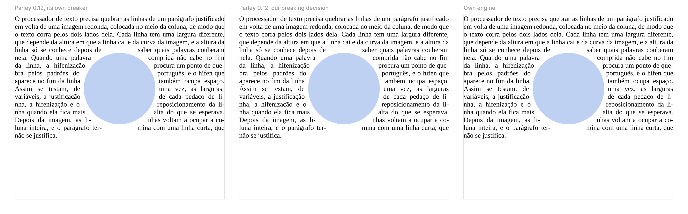

# Text engine proof of concept

Phase 1 of the Desk Writer roadmap starts by deciding how `desk-text` is
built: on top of [Parley](https://github.com/linebender/parley), the text
layout library of the Linebender project, or as an engine of our own. This
program lays out the same paragraph three ways and compares them.

The case is the hard part of page layout: a justified paragraph in Liberation
Serif 11 pt, hyphenated with the Portuguese TeX patterns, wrapped on both
sides of a circle in the middle of a 340 pt column. Every line beside the
circle has its own position and width, which depend on the height where the
line falls, and the hyphen at the end of a line takes room of its own.

```sh
cargo run --release -- result.png
```



## The three ways

1. **Parley with its own breaker.** Parley 0.12 can break one line at a
   time with a position, a width and a maximum height for each line, and
   yields when a line turns out taller than its band, so that the caller can
   move it. That is what wrapping around objects needs. Parley has no
   hyphenation, though: it breaks at a soft hyphen but does not count or draw
   the hyphen. Narrowing such a line by the width of a hyphen and breaking
   again gets close, but three lines came out narrower than their space,
   because the narrowed line then broke at an earlier word.
2. **Parley with our breaking decision.** We choose where each line ends,
   from Parley's shaped clusters and the ICU4X break opportunities, with the
   hyphen counted only where the line ends at a soft hyphen, and commit each
   line to Parley by its length. Parley still shapes, measures, places the
   glyphs and justifies each line to its own width.
3. **Our own engine.** HarfRust for shaping, ICU4X for the break
   opportunities and a greedy breaker, about 200 lines. It handles only this
   case: one font and one style, left to right, no reshaping across a break,
   no bidi, no font fallback, no inline objects and no cursor geometry.

## Results

| | Parley, its breaker | Parley, our decision | Own engine |
|---|---|---|---|
| Lines (beside the circle) | 27 (22) | 27 (22) | 27 (22) |
| Lines inside their space and clear of the circle | all | all | all |
| Lines set narrower than their space | 3 | 0 | 0 |
| Same line breaks as the own engine | no | all 27 | — |
| Time per paragraph, shaping included | about 0.3 ms | about 0.3 ms | about 0.1 ms |

The times are from a release build in the development container, laying out
the paragraph 300 times. Parley spends more because it also does what the own
engine skips (font selection through fontique, bidi, style resolution);
0.3 ms for a paragraph leaves room for laying out again on each keystroke,
since layout only redoes the changed paragraph onwards.

## Decision

`desk-text` builds on Parley, and Desk keeps the line breaking decision:

- Parley gives shaping (HarfRust), font selection and fallback (fontique,
  over fontconfig), bidi, the ICU4X segmentation, glyph placement,
  justification and the geometry for the cursor and selection. These are the
  same libraries the architecture named, already put together and
  maintained.
- Desk decides where each line ends and commits it with
  `break_next_with_length`. That keeps hyphenation, the exclusions of
  wrapped objects and any rule that has to match Pages in our hands, and
  leaves room for a better breaker (a Knuth and Plass style one) later.
- Hyphenation uses the TeX patterns (hyph-utf8) through the `hyphenation`
  crate, with exceptions per word, as phase 4 of the roadmap plans.

Risks, and what to do about them:

- Parley is at version 0.12 and its API changes between versions. Desk pins
  it and hides it behind the `desk-text` API, so a change touches one crate.
- `break_next_with_length` is documented, but lightly used, and
  `set_prior_line_width`, which the first way needed, is hidden from the
  documentation. The chosen way does not need the latter.
- The line spacing modes of Pages (FMT-14: exactly, at least and between)
  and the space before and after (FMT-15) are applied by Desk around
  Parley's lines, not by Parley; the first `desk-text` work checks them
  against the PDFs from the VM.
- The license of the Portuguese hyphenation patterns has to be checked
  before the `hyphenation` crate enters the workspace, since cargo-deny
  only sees the crate's own license.

If Parley stops fitting, the own engine here shows the fallback: the core of
it is small, and what it lacks is the list above that Parley already has.
